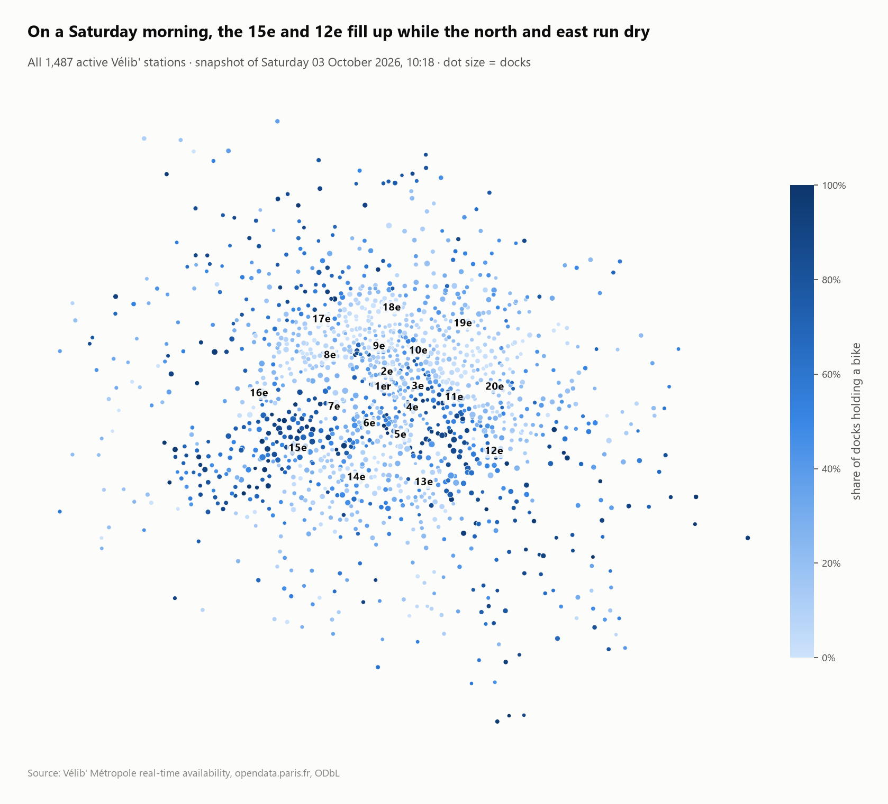
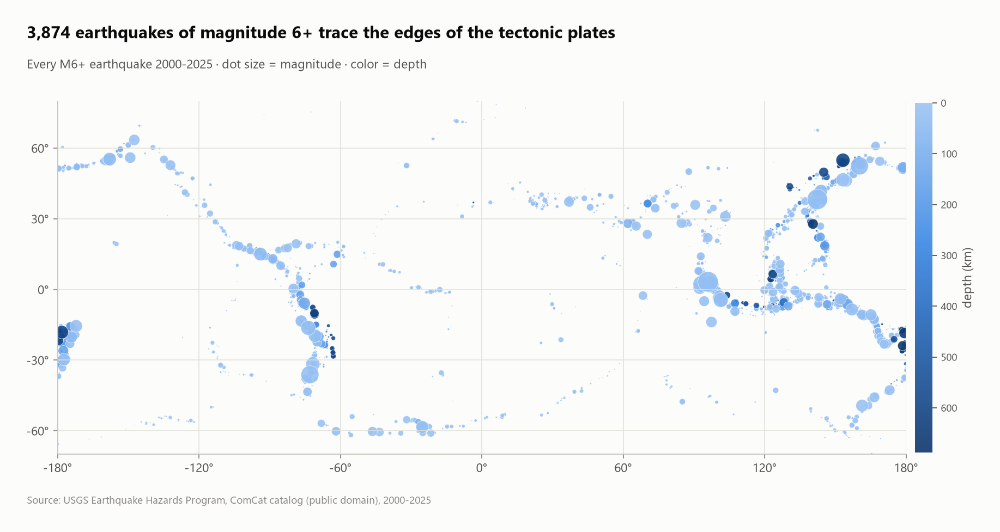
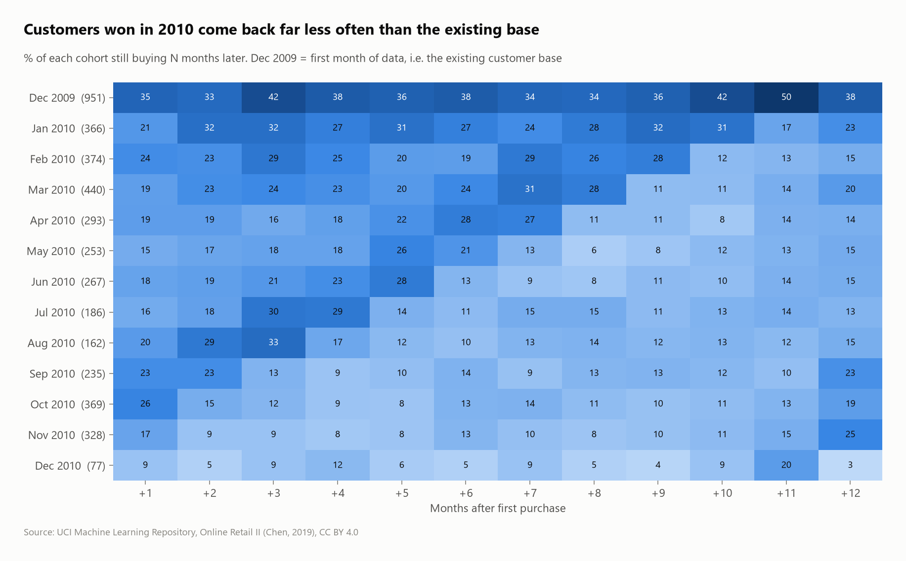
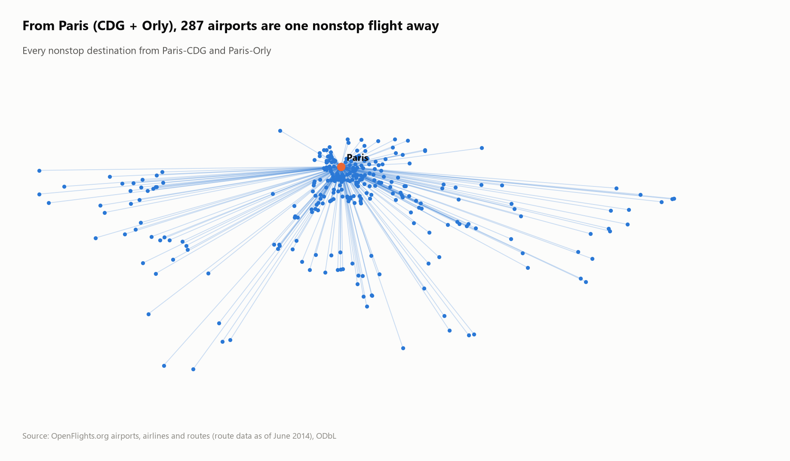

# SQL Portfolio: 18 data projects on real public datasets

Eighteen end-to-end analytics projects. Each one **downloads a real public dataset, loads and cleans it with SQL, answers business questions with SQL, and charts the answers in Python.** Every finding in the READMEs comes from the queries in the repo, and every project rebuilds from scratch with one command.

**Stack:** SQL (DuckDB) · Python (pandas, matplotlib) · Parquet, CSV, Excel, SQLite and REST API sources

| Paris bike-share right now | 76 years of Paris temperatures | Every M6+ earthquake since 2000 |
|---|---|---|
|  |  |  |
| **Customer cohort retention** | **Paris property prices, 2024** | **Paris air network, recursive SQL** |
|  |  |  |

## The projects

| # | Project | Data | Headline finding | SQL highlights |
|---|---|---|---|---|
| 01 | [NYC Taxi Trips](projects/01-nyc-taxi-trips) | NYC TLC, 2.96M trips (Parquet) | JFK alone brings in 14.3% of all taxi revenue | data-quality tagging, moving averages, `QUALIFY` |
| 02 | [Chinook Music Store](projects/02-chinook-music-store) | Sample DB, 11 tables (SQLite) | 43% of the catalog has never sold | `ATTACH` SQLite, 6-table joins, `ntile`, top-N per group |
| 03 | [Online Retail: Cohorts & RFM](projects/03-online-retail-cohorts) | UCI, 1.07M lines (Excel) | 24% of customers make 80% of revenue | cohort retention, RFM, Pareto, cancellation matching |
| 04 | [Paris Real Estate (DVF)](projects/04-paris-real-estate) | Land registry, 155,793 rows | Prices fell in all 20 arrondissements in 2024 (−5.6%) | re-graining, `FILTER` pivots, percentiles |
| 05 | [Paris Airbnb](projects/05-paris-airbnb) | Inside Airbnb, 77,679 listings | 1 entire home in 8 has no valid registration number | regex validation, reused-identifier detection |
| 06 | [Vélib' Paris](projects/06-velib-paris) | Live API, 1,519 stations | 4× fill gap between the 15e and the 18e; stations silent since 2021 | feed-health rules, geo parsing |
| 07 | [RATP Métro Traffic](projects/07-ratp-metro-traffic) | RATP, 9 yearly files | Business districts recovered least after COVID (9e: 61%) | multi-file ingestion, `lag`, `dense_rank`, like-for-like |
| 08 | [Paris Trees](projects/08-paris-trees) | Paris open data, 220,174 trees | Over half the street trees of the 5e–8e are one genus | sentinel-value cleaning, top-1 per group |
| 09 | [CO₂ Emissions](projects/09-co2-emissions) | Our World in Data, 1750–2024 | Summing every row overcounts world CO₂ 6.4× | grain control, latest-year-per-entity |
| 10 | [Energy Transition](projects/10-energy-transition) | Our World in Data, 2000–2025 | Wind + solar passed nuclear in 2021 and hydro in 2025 | `UNPIVOT`, `lag` in percentage points |
| 11 | [Paris Climate 1950–2025](projects/11-paris-climate) | Open-Meteo (ERA5), 27,759 days | +0.42 °C per decade since 1980; 5× more 30 °C days | `regr_slope`, baselines and anomalies |
| 12 | [Earthquakes 2000–2025](projects/12-earthquakes) | USGS API, 46,522 events | Gutenberg–Richter b = 1.02 (R² 0.998), fitted in SQL | regression in SQL, `log10`, waiting times |
| 13 | [MovieLens Ratings](projects/13-movielens-ratings) | GroupLens, 100,836 ratings | 296 movies have a "perfect" 5.0 average from 1–2 votes | Bayesian weighted rating, `unnest` |
| 14 | [Chicago Crime 2024](projects/14-chicago-crimes) | City of Chicago API, 259,638 crimes | 9,443 crimes carry a fake 00:00 timestamp | SQL macros, generated calendar, timestamp forensics |
| 15 | [OpenFlights Network](projects/15-openflights-network) | OpenFlights, 67,663 routes | 89% of the world's airports are within 2 connections of Paris | `WITH RECURSIVE`, haversine macro |
| 16 | [Formula 1, 1950–2026](projects/16-formula1-history) | F1DB, 27,621 results | Pole wins 43.6% of races; Verstappen 2023 won 86% | 7-table model, `EXISTS`, partitioned ranks |
| 17 | [French First Names](projects/17-french-first-names) | INSEE, 6.45M rows (Parquet) | Top-10 names: 43% of babies in 1900 → 9.6% in 2024 | `arg_max`, ranks by sex and region |
| 18 | [Road Accidents in France](projects/18-france-road-accidents) | ONISR, 4 tables, 125,187 people | Rural roads: 38% of accidents, 68% of deaths | join fan-out control, multi-table joins |

## What these projects show
- **Data quality first.** Every project starts by checking the data, and most found real problems:
  - duplicated Excel sheets (03) and cancelled orders still counted as sales (03);
  - double-counted aggregates (09) and fake placeholder timestamps (14);
  - US airports relabeled as African ones (15), nuclear tests in an earthquake catalog (12);
  - a 29% join fan-out (18).
- **Honest numbers.** Where data limits a conclusion (one snapshot, estimated occupancy, reanalysis smoothing, stations opening mid-period), the README says so.
- **Reproducible pipelines.** Raw data is never committed; `run.py` re-downloads it, rebuilds the DuckDB database and regenerates every result and chart.

## Run it
```bash
python -m venv .venv
```
```bash
.venv\Scripts\activate        # macOS/Linux: source .venv/bin/activate
```
```bash
pip install -r requirements.txt
```
```bash
python run_all.py                       # all 18 projects
```
```bash
python run_all.py 04-paris-real-estate  # or a single one
```
Every project folder has the same layout:
```
projects/NN-name/
├── sql/01_load.sql       load + clean the raw files into DuckDB tables
├── sql/02_analysis.sql   the questions, one "-- name:" query each
├── visualize.py          charts from the query results
├── run.py                download -> load -> analyze -> visualize
├── results/*.csv         every query result (the table view of each chart)
├── images/*.png          the charts
└── README.md             questions, findings, techniques, data source
```
`toolkit/` holds the shared pipeline (download with retries, a named-query runner) and the chart style.

## Data sources and licenses
All datasets are public and free to download, and each project README links its exact source. Licenses include Licence Ouverte (data.gouv.fr, INSEE, DGFiP, ONISR), ODbL (Paris, RATP, OpenFlights), CC BY 4.0 (Our World in Data, Inside Airbnb, Open-Meteo, F1DB, UCI) and public domain (USGS, NYC TLC). MovieLens is for research use and is downloaded, not redistributed.
