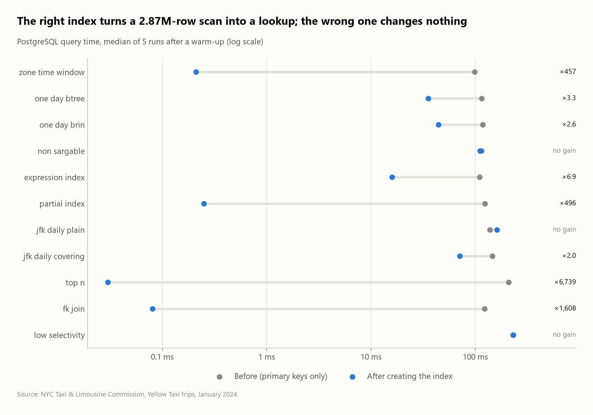

# NYC Taxi Trips: demand, revenue and traffic

Analysis of **2.96 million** New York yellow-taxi trips (January 2024) with SQL in DuckDB, read straight from the official Parquet file, and charted with Python. The clean trips are then copied into **PostgreSQL** to benchmark 11 indexing strategies on 2.87M rows.


## Questions
1. How much of the raw data is usable, and why are rows rejected?
2. When do New Yorkers take taxis (day of week × hour)?
3. Which pickup zones bring in the most revenue?
4. How do airport trips compare with the rest of the city?
5. How does Manhattan traffic speed change during the day?
6. How much do riders tip, depending on trip length?
7. How does revenue split by borough and payment type, with subtotals? (`ROLLUP`)
8. Which zone-to-zone flows are the most one-directional? (self-join)
9. Which payment types have abnormally high fares for their route? (per-route quartiles)
10. Where do airport passengers go? (`LATERAL` top-3 per airport)
11. **PostgreSQL:** which indexes make which queries faster, and which don't?

## Key findings
- **Data quality:** 96.7% of rows pass the cleaning rules. The biggest problems are zero or impossible distances (2.0%) and non-positive fares (1.2%), so every query runs on 2,867,592 clean trips.
- **Demand peaks on weekday evenings:** the busiest hour is **Thursday at 18:00** (about 8,200 trips/hour on average). Weekend midnights see about **3.5× more trips than weekday midnights** (about 4,900 vs 1,300 trips/hour).
- **Airports dominate revenue:** JFK brings in **$11.2M (14.3% of all revenue)**, 3.3× more than Midtown Center, the top Manhattan zone ($3.4M). The two NYC airports together account for 21.7%.
- **An airport ride is worth 3.5 city rides:** JFK pickups average $80.83 for 15.8 miles, against $23.24 for 2.4 miles elsewhere.
- **Traffic:** Manhattan taxis crawl at **8.5 mph at 14:00**, against 14.3 mph at 05:00.
- **Tipping:** card-paying riders tip **31.6% of the fare on trips under a mile**, against 21.3% on 3–10 mile trips. People seem to round up small fares, and 10.9% of 10+ mile rides get no tip at all.
- **Airport trips are one-way:** 3,180 trips went from JFK to Clinton East but only 833 came back (3.8×). Midtown South is 3.1×. Many travelers take a cab *from* the airport but get back to it some other way. The most one-sided pair without an airport is Upper East Side North → East Harlem South (4,837 vs 1,621, 3.0×).
- **Abnormal fares cluster on disputed payments:** 2.8% of disputed trips have a fare above Q3 + 3×IQR of their own route, 3.9× the rate of card trips (0.7%).
- **Manhattan is 90% of trips but 75% of revenue.** Queens (mostly the airports) earns $18.6M from 9% of trips. Cash is 14.3% of Manhattan pickups and 19.3% of Queens pickups.

| Revenue by zone | Daily volume |
|---|---|
|  |  |

## PostgreSQL: index benchmarks
The 2.87M clean trips are copied into PostgreSQL 18 (`sql/03_postgres_schema.sql`: primary keys, foreign keys, CHECK constraints, exact `NUMERIC` money). Each query in `sql/04_index_benchmarks.sql` is timed with the primary keys only, then again after creating its index. The timing is the median of 5 `EXPLAIN ANALYZE` runs after a warm-up, the result must be identical both times, and the full before/after plans are saved in [`results/plans/`](results/plans).



| Query | Index | Before → after | Why |
|---|---|---|---|
| `top_n`: 10 most expensive trips | B-tree `(total_amount DESC)` | 209 → 0.03 ms | reads the first 10 index entries instead of sorting 2.87M rows |
| `fk_join`: trips from one zone, by name | B-tree on the foreign key | 122 → 0.08 ms | Postgres does **not** index foreign keys by itself |
| `zone_time_window`: one zone, two hours | composite `(pickup_zone_id, pickup_at)` | 98 → 0.21 ms | equality column first, range second: one contiguous, pre-sorted slice |
| `partial_index`: disputes over $100 | `(total_amount) WHERE payment = 'Dispute'` | 123 → 0.25 ms | indexes only 0.8% of rows: 0.5 MB instead of ~65 MB |
| `expression_index`: `pickup_at::date = …` | `((pickup_at::date))` | 109 → 16 ms | matches the expression the query filters on |
| `one_day_btree` / `one_day_brin`: one day | B-tree vs BRIN on `pickup_at` | 115 → 35 / 44 ms | BRIN is **0.02 MB vs 52.8 MB**: it only works because rows are stored in time order |
| `jfk_daily_covering`: JFK revenue per day | `(pickup_zone_id) INCLUDE (pickup_at, total_amount)` | 145 → 71 ms | Index Only Scan: the table is never read |
| `non_sargable`: same day, cast on the column | B-tree on `pickup_at` | **no gain** | `pickup_at::date = …` can't use an index on `pickup_at` |
| `jfk_daily_plain`: 138k JFK rows | B-tree `(pickup_zone_id)` | **no gain** | 5% of the table: fetching each row costs as much as scanning |
| `low_selectivity`: card trips (80%) | B-tree `(payment)` | **no gain** | the planner rightly keeps the parallel sequential scan |

The three "no gain" rows matter as much as the wins: an index only helps when the predicate can use it and is selective enough. Timings depend on the machine; the ratios and plans are what to compare.

## SQL techniques
- **Data-quality tagging** with an ordered `CASE` (first failing rule wins), so every rejected row is explained (`sql/01_load.sql`)
- **Window functions:** 7-day moving average (`ROWS BETWEEN 6 PRECEDING`), share of total (`sum(...) OVER ()`), `rank()` with `QUALIFY`
- **CTEs**, multi-way **joins** to a lookup table, date functions (`isodow`, `hour`, `date_diff`), `median`
- **Star schema with enforced constraints:** `PRIMARY KEY`, `FOREIGN KEY ... REFERENCES`, `CHECK` restating the cleaning rules, so a bad row fails the load
- **`ROLLUP` + `grouping()`** for subtotals, with `first_value()` over the grouping level to compute shares within each subtotal
- **Self-join** of a flow table (A→B vs B→A), per-group **`quantile_cont`** for Tukey fences, **`LATERAL`** top-N per row
- **PostgreSQL indexing:** composite, partial, covering (`INCLUDE`), expression and BRIN indexes, read through `EXPLAIN (ANALYZE, BUFFERS)`

## Dataset
| | |
|---|---|
| Source | [NYC Taxi & Limousine Commission – Trip Record Data](https://www.nyc.gov/site/tlc/about/tlc-trip-record-data.page) |
| Files | `yellow_tripdata_2024-01.parquet` (50 MB, 2,964,624 rows), `taxi_zone_lookup.csv` (265 zones) |
| Terms | NYC Open Data, free to use |

## Run it
```bash
pip install -r ../../requirements.txt
python run.py          # download -> load -> analyze -> postgres benchmarks -> charts
```
The PostgreSQL step uses the server in `PG_DSN`. If that isn't set, it uses a local server on port 5433 (`docker compose up -d` from the repo root, or a PostgreSQL install, which the toolkit starts as a private cluster in `.pgdata/`). With no PostgreSQL at all, the step is skipped.
Query results are written to `results/*.csv` and charts to `images/`.

## Files
```
sql/01_load.sql       clean + quality-tag the raw trips
sql/02_analysis.sql   the questions, one named query each
sql/03_postgres_schema.sql    the same tables in PostgreSQL (constraints only)
sql/04_index_benchmarks.sql   one query + the index under test, each
visualize.py          charts from the query results
run.py                the whole pipeline
```
