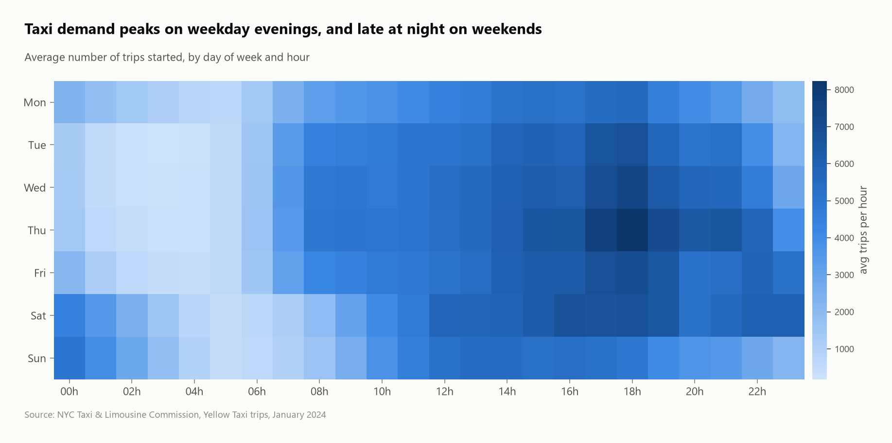
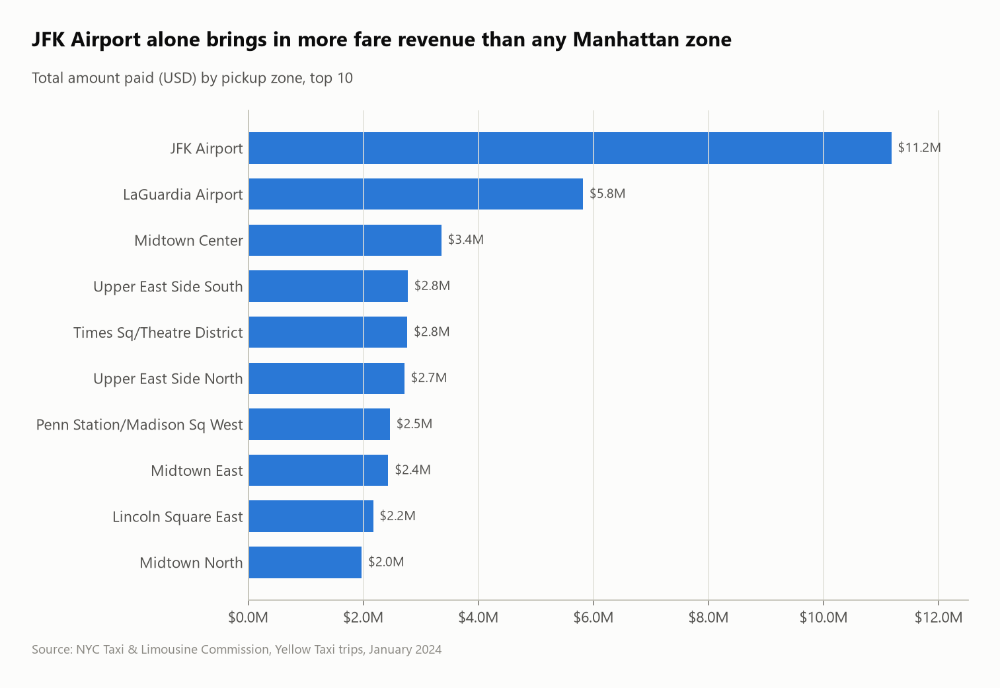
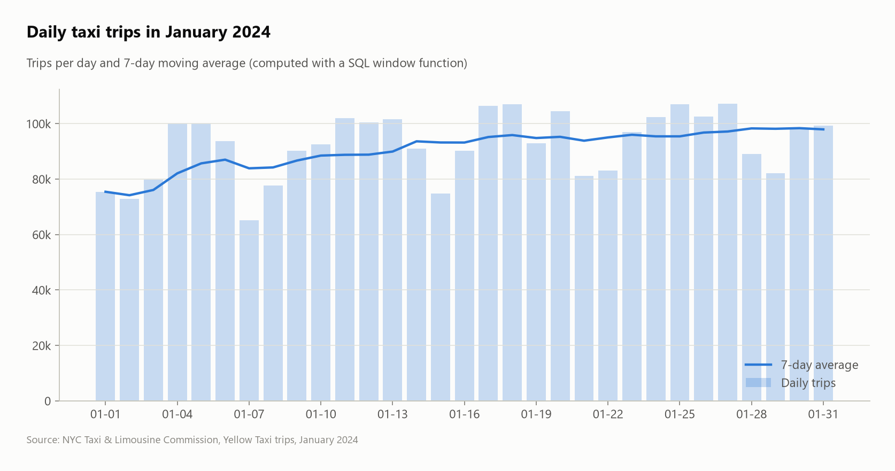

# NYC Taxi Trips: demand, revenue and traffic

Analysis of **2.96 million** New York yellow-taxi trips (January 2024) with SQL in DuckDB, read straight from the official Parquet file, and charted with Python.



## Questions
1. How much of the raw data is usable, and why are rows rejected?
2. When do New Yorkers take taxis (day of week × hour)?
3. Which pickup zones bring in the most revenue?
4. How do airport trips compare with the rest of the city?
5. How does Manhattan traffic speed change during the day?
6. How much do riders tip, depending on trip length?

## Key findings
- **Data quality:** 96.7% of rows pass the cleaning rules. The biggest problems are zero or impossible distances (2.0%) and non-positive fares (1.2%), so every query runs on 2,867,592 clean trips.
- **Demand peaks on weekday evenings:** the busiest hour is **Thursday at 18:00** (about 8,200 trips/hour on average). Weekend midnights see about **3.5× more trips than weekday midnights** (about 4,900 vs 1,300 trips/hour).
- **Airports dominate revenue:** JFK brings in **$11.2M (14.3% of all revenue)**, 3.3× more than Midtown Center, the top Manhattan zone ($3.4M). The two NYC airports together account for 21.7%.
- **An airport ride is worth 3.5 city rides:** JFK pickups average $80.83 for 15.8 miles, against $23.24 for 2.4 miles elsewhere.
- **Traffic:** Manhattan taxis crawl at **8.5 mph at 14:00**, against 14.3 mph at 05:00.
- **Tipping:** card-paying riders tip **31.6% of the fare on trips under a mile**, against 21.3% on 3–10 mile trips. People seem to round up small fares, and 10.9% of 10+ mile rides get no tip at all.

| Revenue by zone | Daily volume |
|---|---|
|  |  |

## SQL techniques
- **Data-quality tagging** with an ordered `CASE` (first failing rule wins), so every rejected row is explained (`sql/01_load.sql`)
- **Window functions:** 7-day moving average (`ROWS BETWEEN 6 PRECEDING`), share of total (`sum(...) OVER ()`), `rank()` with `QUALIFY`
- **CTEs**, multi-way **joins** to a lookup table, date functions (`isodow`, `hour`, `date_diff`), `median`

## Dataset
| | |
|---|---|
| Source | [NYC Taxi & Limousine Commission – Trip Record Data](https://www.nyc.gov/site/tlc/about/tlc-trip-record-data.page) |
| Files | `yellow_tripdata_2024-01.parquet` (50 MB, 2,964,624 rows), `taxi_zone_lookup.csv` (265 zones) |
| Terms | NYC Open Data, free to use |

## Run it
```bash
pip install -r ../../requirements.txt
python run.py          # download -> load -> analyze -> charts
```
Query results are written to `results/*.csv` and charts to `images/`.

## Files
```
sql/01_load.sql       clean + quality-tag the raw trips
sql/02_analysis.sql   the questions, one named query each
visualize.py          charts from the query results
run.py                the whole pipeline
```
