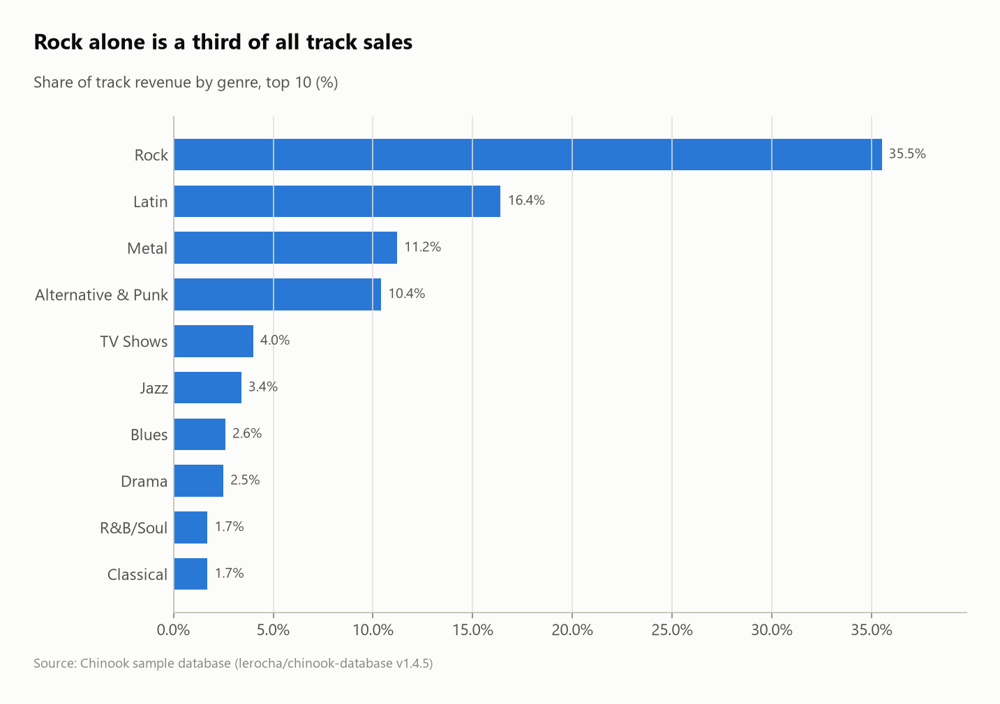
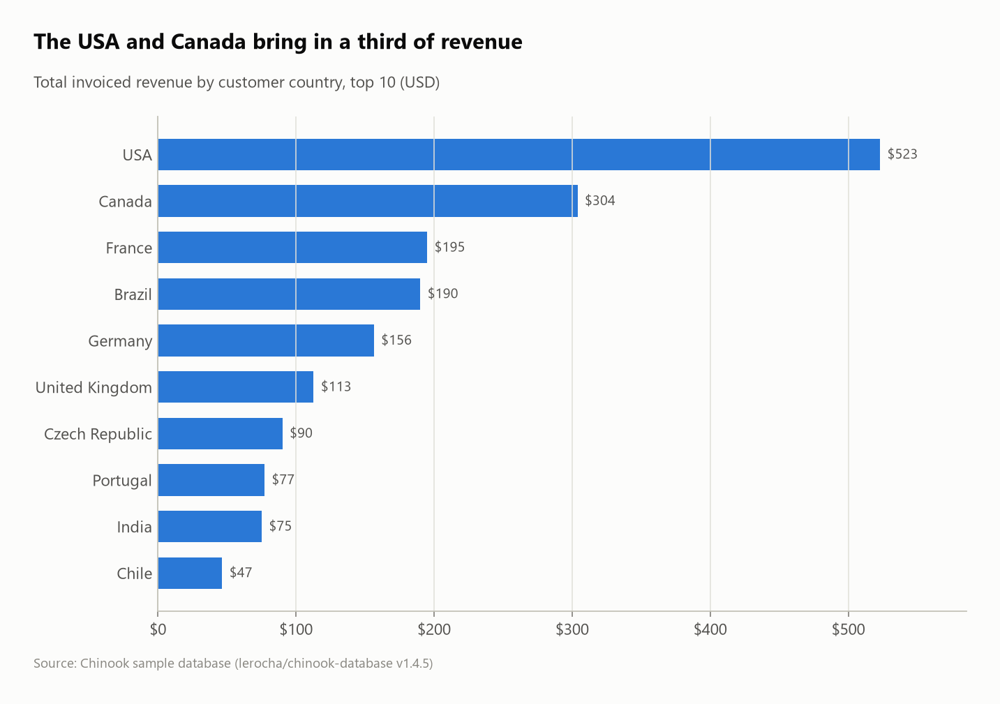
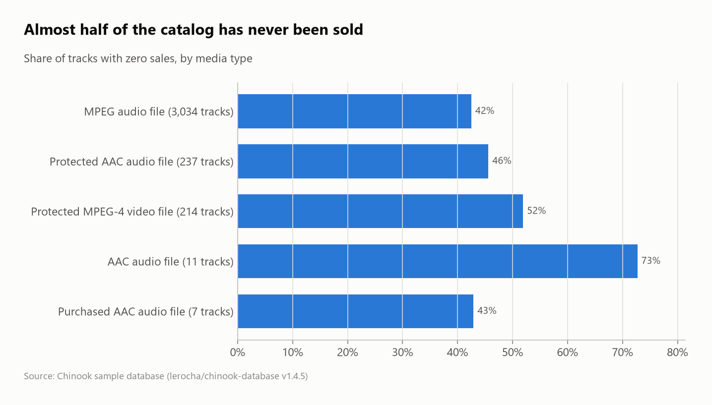

# Chinook Music Store: sales analysis on a relational database

The classic **Chinook** database (a digital music store: 11 tables, 412 invoices, 3,503 tracks) copied from SQLite into DuckDB, then analyzed with joins and window functions.

> Chinook is a **sample database with generated sales**, which makes it ideal for practicing relational SQL. Its time trends are artificially flat (monthly revenue is $37.62 almost every month), so this project focuses on structure: who buys what, where, and through which rep.



## Questions
1. Is the data consistent (invoice totals vs invoice lines, orphan lines)?
2. Which countries and genres generate the revenue?
3. How does revenue evolve year over year?
4. How do the three sales reps compare?
5. How is customer lifetime value distributed?
6. Who is the best-selling artist in each market?
7. How much of the catalog never sells?

## Key findings
- **Clean data:** all 412 invoice totals match the sum of their lines, and no line points to a missing track.
- **Rock is 35.5% of track revenue,** followed by Latin (16.4%) and Metal (11.2%). Video content (TV Shows, Drama) sells few units but at $1.99 a track.
- **The USA (22.5%) and Canada (13.1%) bring in over a third of revenue.** Revenue per customer barely varies ($37–46), so market size is simply the number of customers.
- **Flat sales:** 2009–2013 revenue stays between $449 and $481 a year (YoY between −5.6% and +7.1%), a sign of generated data.
- **Sales reps:** Jane Peacock leads with $833 over 21 customers, against $720 for Steve Johnson (18 customers).
- **Iron Maiden is the top artist in 4 of the 8 biggest markets** (USA, Germany, Portugal, Czech Republic).
- **43.4% of the catalog (1,519 of 3,503 tracks) has never been sold,** and over half of the protected video files.

| Revenue by country | Unsold catalog |
|---|---|
|  |  |

## SQL techniques
- Loading from another database engine (`ATTACH ... (TYPE sqlite)`) and renaming to a clean snake_case model
- **Integrity checks** with scalar subqueries and anti-joins (`LEFT JOIN ... WHERE ... IS NULL`)
- Window functions: `lag()` for YoY growth, rolling average, `rank()`, `ntile(4)` segmentation, `row_number()` **top-N per group**
- `FILTER (WHERE ...)` aggregates, 6-table joins, CTE pipelines

## Dataset
| | |
|---|---|
| Source | [lerocha/chinook-database](https://github.com/lerocha/chinook-database) (release v1.4.5) |
| Size | 11 tables, 412 invoices, 2,240 invoice lines, 59 customers, 3,503 tracks |
| License | MIT |

## Run it
```bash
pip install -r ../../requirements.txt
python run.py
```
