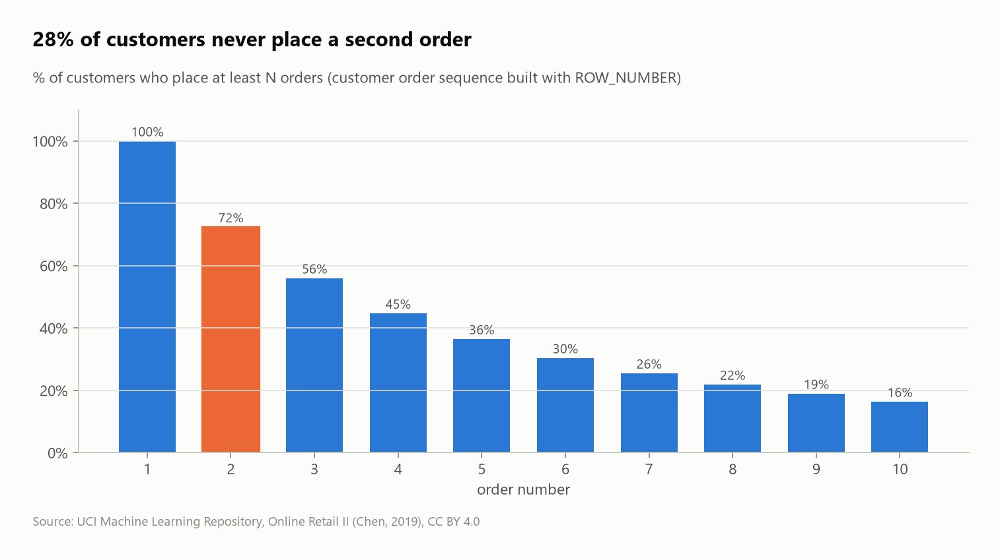
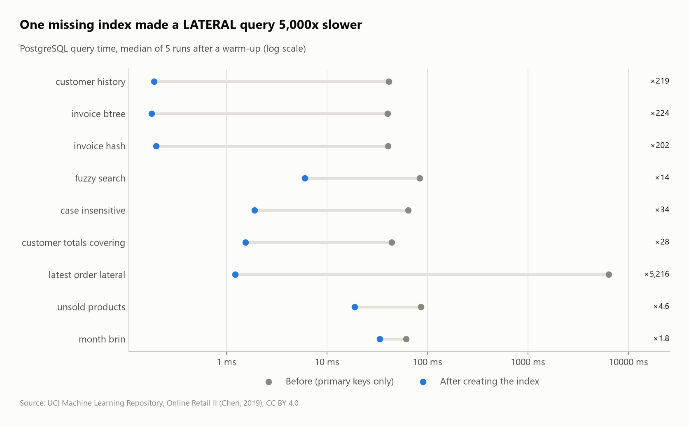

# Online Retail: cohort retention and RFM segmentation

Customer analytics on **1,067,371 line items** of a UK online gift retailer (Dec 2009 – Dec 2011), loaded straight from the original Excel workbook into DuckDB. The project covers cleaning, cohort retention, RFM segmentation, Pareto analysis, market-basket analysis and gaps-and-islands streaks, all in SQL. The clean star schema is then copied into **PostgreSQL** to benchmark 9 indexing strategies.


## Questions
1. What has to be cleaned before the data can be trusted?
2. Do customers come back after their first purchase (monthly cohort retention)?
3. Who are the best customers (RFM segments)?
4. How concentrated is revenue (Pareto)?
5. What are the seasonality, the best products and the main markets?
6. How long until a customer orders again, and how many ever do? (`LAG`, `ROW_NUMBER`)
7. Which products are bought together? (self-join, support / confidence / lift)
8. How many consecutive months do customers stay active? (gaps and islands)
9. Revenue by market and year with every subtotal (`CUBE`)
10. **PostgreSQL:** which indexes speed up the shop's typical queries?

## Key findings
- **Only 73% of raw lines are real, attributable sales.** 21.2% have no customer ID and 1.8% are cancellations. Two less obvious problems turned up:
  - **The two Excel sheets overlap** on 1–9 December 2010, which would have counted 22,523 lines twice.
  - **9,754 purchases were reversed by a later cancellation** for the same customer, product and quantity. Without that rule, a single 80,995-unit order (cancelled the same day) would rank as the #3 product.
- **Customers won in 2010 rarely stay:** in each month after their first purchase, only **16.5%** of them buy again on average, against **37.9%** for the December 2009 cohort. That first cohort is really the shop's existing customer base, since it's the first month of data.
- **Champions (21.4% of customers) produce 68.7% of revenue.** 28% of customers are "Lost": no purchase for a median of 431 days.
- **Pareto:** **23.8% of customers make 80% of revenue** (1,392 of 5,838).
- **Strong seasonality:** November is the peak month in both years (£1.12M in 2010, £1.13M in 2011), about double the spring months.
- **The UK is 83.5% of revenue,** but foreign customers place bigger orders: Dutch orders average £2,548 against £414 for UK orders.
- **27.6% of customers never place a second order.** Those who do come back after a median of **57 days**, and the gap shrinks with each order (29 days by the 10th order).
- **Customers buy color sets:** 81.5% of orders with the blue children's garden fork also contain the pink one, **95.6× more often than chance (lift)**. The skull paper cups and plates have a lift of 83.5.
- **Loyalty in streaks:** 58.7% of customers never buy in two consecutive months, but the 88 customers (1.5%) with a **12+ month streak** spend **£42,058 on average, 55× more** than one-month customers (£771).

| Seasonality | RFM segments |
|---|---|
|  |  |



## PostgreSQL: index benchmarks
The clean star schema (`products`, `customers`, `sales` with primary keys, foreign keys and CHECK constraints) is copied into PostgreSQL 18 (`sql/03_postgres_schema.sql`). Each query in `sql/04_index_benchmarks.sql` is timed with the primary keys only, then again after creating its index. The timing is the median of 5 `EXPLAIN ANALYZE` runs after a warm-up, the result must be identical both times, and the before/after plans are in [`results/plans/`](results/plans).



| Query | Index | Before → after | Lesson |
|---|---|---|---|
| `latest_order_lateral`: last order of 106 customers | `(customer_id, invoiced_at DESC)` | **6.4 s → 1.2 ms** | without it, the `LATERAL` subquery scans 778k lines **once per customer** |
| `invoice_btree` / `invoice_hash`: one invoice | B-tree vs hash on `invoice` | 40 → 0.2 ms (both) | the hash index is **26 MB vs 6.1 MB**: B-tree deduplication (PG 13+) beats the textbook |
| `customer_history`: one customer, newest first | `(customer_id, invoiced_at DESC)` | 41 → 0.19 ms | rows come out of the index already sorted |
| `case_insensitive`: `lower(description) = …` | expression index `(lower(description))` | 64 → 1.9 ms | the index must match the expression |
| `customer_totals_covering`: 40 customers' totals | `(customer_id) INCLUDE (invoice, revenue)` | 44 → 1.6 ms | Index Only Scan, the table is never read |
| `fuzzy_search`: `ILIKE '%babushka%'` | trigram GIN (`pg_trgm`) | 84 → 6.0 ms | a B-tree can't serve a leading wildcard; trigrams can |
| `unsold_products`: `NOT EXISTS` since June 2011 | `(stock_code, invoiced_at)` | 86 → 19 ms | each anti-join probe becomes an index-only lookup |
| `month_brin`: one month of sales | BRIN on `invoiced_at` | 61 → 34 ms | **0.02 MB** of index, because lines are stored in time order |

Timings depend on the machine; the ratios and plans are what to compare.

## SQL techniques
- Reading Excel (`read_xlsx`) with explicit typing, and **Excel serial dates** → timestamps
- **Ordered data-quality rules** with `CASE`, including an **anti-duplicate rule across sheets** and **`EXISTS` matching of cancellations to their original orders**
- **Cohort analysis:** `date_trunc` + `date_diff('month', ...)`, cohort sizes via CTE
- **RFM** with tie-aware quintile scores (`percent_rank()`, because `ntile()` splits tied customers arbitrarily); **Pareto** with a running `sum() OVER (ORDER BY ... ROWS UNBOUNDED PRECEDING)`
- Share-of-total windows, `median`, `any_value`, `mode`
- **Star schema with enforced constraints** (`PRIMARY KEY`, `FOREIGN KEY`, `CHECK`): products, customers, sales
- **Customer order sequences** with a named `WINDOW` clause shared by `row_number()` and `lag()`
- **Market-basket analysis:** a self-join of invoice lines into product pairs, with support, confidence and lift
- **Gaps and islands:** `month index − row_number()` is constant within a run of consecutive months
- **`CUBE` + `grouping()`** for every subtotal combination
- **PostgreSQL indexing:** composite, hash, trigram GIN, expression, covering (`INCLUDE`) and BRIN indexes; `LATERAL` and `NOT EXISTS` plans

## Dataset
| | |
|---|---|
| Source | [UCI Machine Learning Repository – Online Retail II](https://archive.ics.uci.edu/dataset/502/online+retail+ii) (Chen, 2019) |
| File | `online_retail_II.xlsx`, 2 sheets, 1,067,371 rows |
| License | CC BY 4.0 |

## Run it
```bash
pip install -r ../../requirements.txt
python run.py          # download -> load -> analyze -> postgres benchmarks -> charts
```
The PostgreSQL step uses the server in `PG_DSN`. If that isn't set, it uses a local server on port 5433 (`docker compose up -d` from the repo root, or a PostgreSQL install, which the toolkit starts as a private cluster in `.pgdata/`). With no PostgreSQL at all, the step is skipped.
