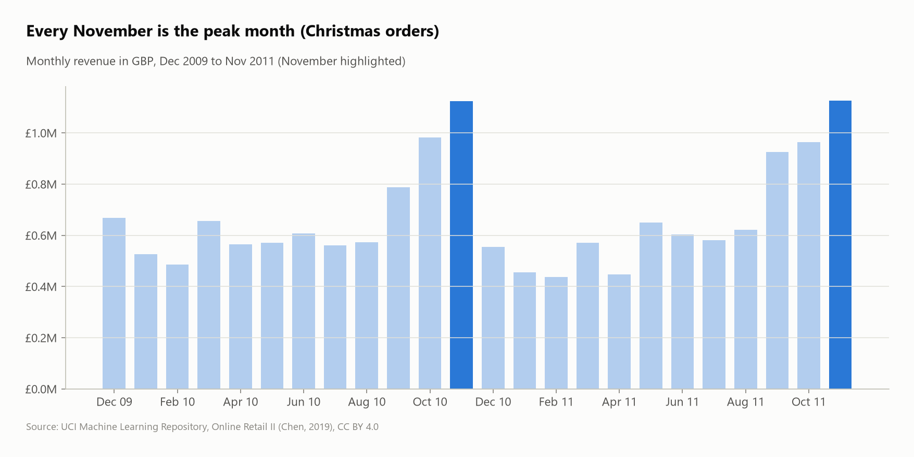
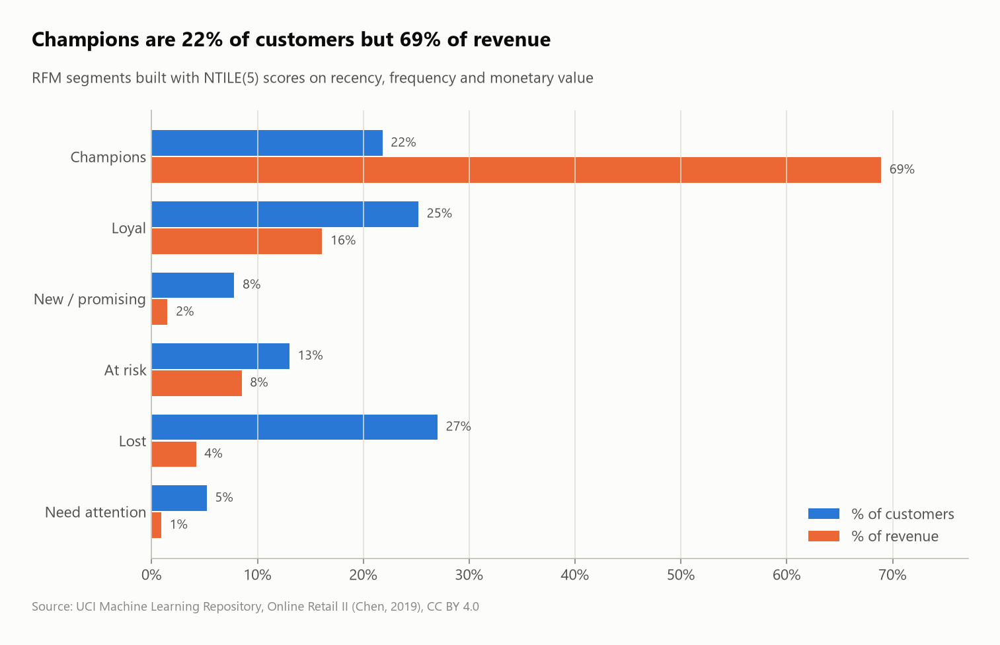

# Online Retail: cohort retention and RFM segmentation

Customer analytics on **1,067,371 line items** of a UK online gift retailer (Dec 2009 – Dec 2011), loaded straight from the original Excel workbook into DuckDB. The project covers cleaning, cohort retention, RFM segmentation and Pareto analysis, all in SQL.


## Questions
1. What has to be cleaned before the data can be trusted?
2. Do customers come back after their first purchase (monthly cohort retention)?
3. Who are the best customers (RFM segments)?
4. How concentrated is revenue (Pareto)?
5. What are the seasonality, the best products and the main markets?

## Key findings
- **Only 73% of raw lines are real, attributable sales.** 21.2% have no customer ID and 1.8% are cancellations. Two less obvious problems turned up:
  - **The two Excel sheets overlap** on 1–9 December 2010, which would have counted 22,523 lines twice.
  - **9,754 purchases were reversed by a later cancellation** for the same customer, product and quantity. Without that rule, a single 80,995-unit order (cancelled the same day) would rank as the #3 product.
- **Customers won in 2010 rarely stay:** in each month after their first purchase, only **16.5%** of them buy again on average, against **37.9%** for the December 2009 cohort. That first cohort is really the shop's existing customer base, since it's the first month of data.
- **Champions (21.8% of customers) produce 68.9% of revenue.** 27% of customers are "Lost": no purchase for a median of 435 days.
- **Pareto:** **23.8% of customers make 80% of revenue** (1,392 of 5,838).
- **Strong seasonality:** November is the peak month in both years (£1.12M in 2010, £1.13M in 2011), about double the spring months.
- **The UK is 83.5% of revenue,** but foreign customers place bigger orders: Dutch orders average £2,548 against £414 for UK orders.

| Seasonality | RFM segments |
|---|---|
|  |  |

## SQL techniques
- Reading Excel (`read_xlsx`) with explicit typing, and **Excel serial dates** → timestamps
- **Ordered data-quality rules** with `CASE`, including an **anti-duplicate rule across sheets** and **`EXISTS` matching of cancellations to their original orders**
- **Cohort analysis:** `date_trunc` + `date_diff('month', ...)`, cohort sizes via CTE
- **RFM** with three `ntile(5)` windows; **Pareto** with a running `sum() OVER (ORDER BY ... ROWS UNBOUNDED PRECEDING)`
- Share-of-total windows, `median`, `any_value`

## Dataset
| | |
|---|---|
| Source | [UCI Machine Learning Repository – Online Retail II](https://archive.ics.uci.edu/dataset/502/online+retail+ii) (Chen, 2019) |
| File | `online_retail_II.xlsx`, 2 sheets, 1,067,371 rows |
| License | CC BY 4.0 |

## Run it
```bash
pip install -r ../../requirements.txt
python run.py
```
