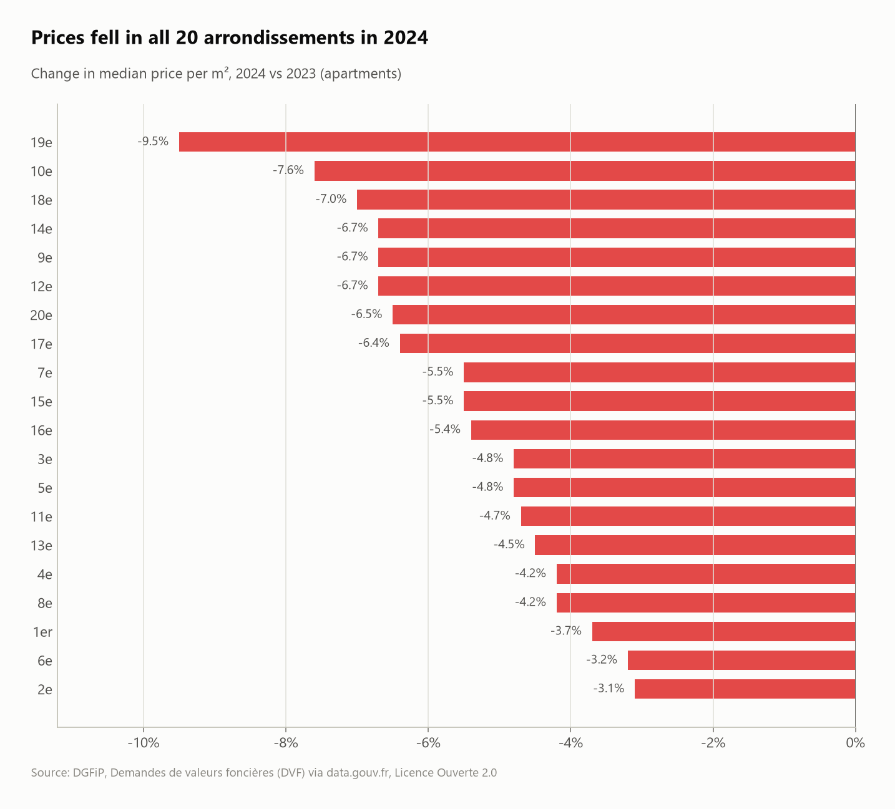
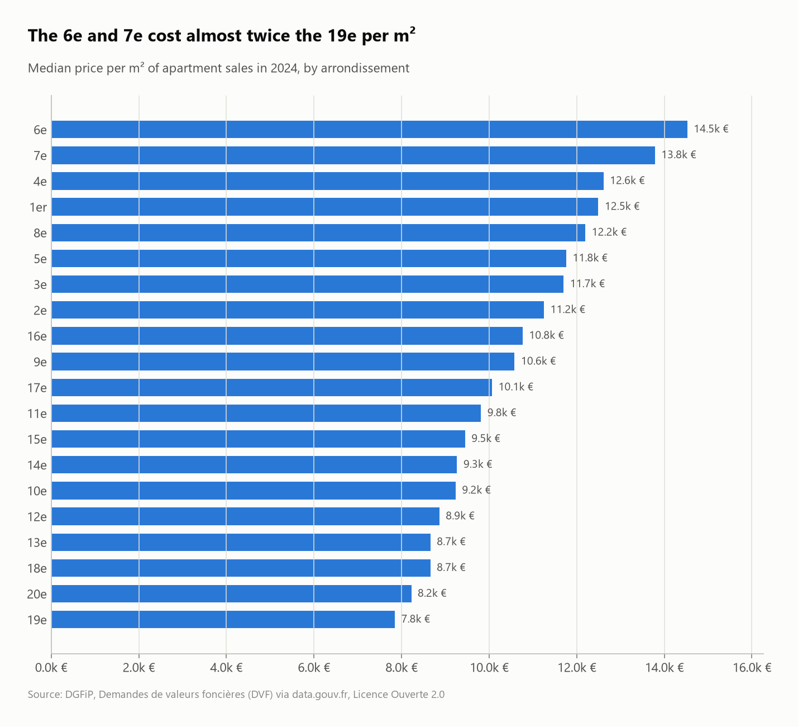
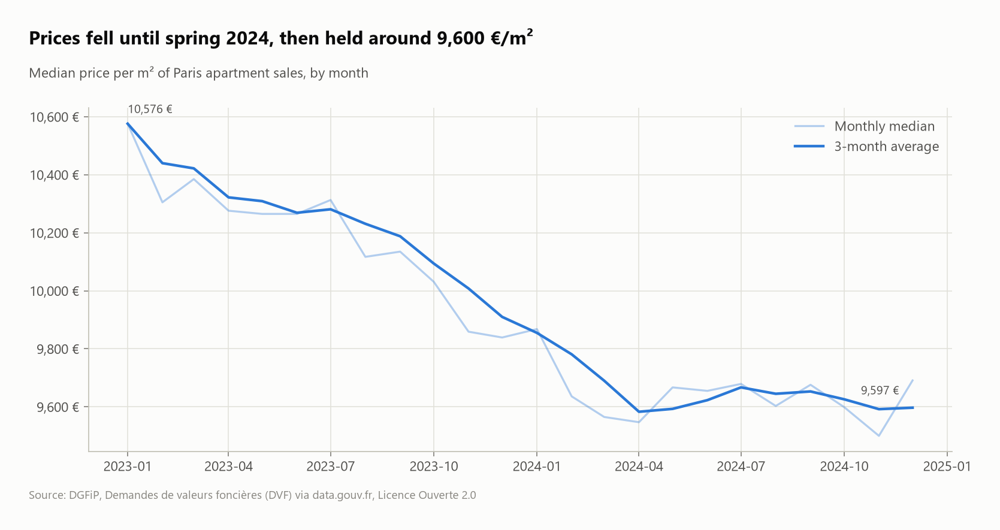

# Paris real estate: two years of apartment sales (DVF)

Every property sale registered in Paris in **2023 and 2024** (official DVF land-registry data: 155,793 rows, 75,571 sales), cleaned down to **51,209 standard apartment sales**, then analyzed with SQL: prices per m², arrondissement ranking, the 2024 correction, and the most expensive streets.



## Questions
1. How do you turn raw DVF rows (one row per lot) into one clean price per m² per sale?
2. What does an apartment cost per m² in each arrondissement?
3. How did prices move between 2023 and 2024?
4. Are small apartments more expensive per m²?
5. Which streets are the most expensive?

## Key findings
- **Only 67.8% of sales are usable "one apartment" sales.** 22.6% contain no apartment at all (parking spaces, cellars, shops), 4.9% are bulk or mixed sales whose single price can't be split, and 2.8% have an implausible price per m².
- **Prices fell in all 20 arrondissements:** the Paris median dropped from **€10,218 to €9,642 per m² (−5.6%)**. The 19e fell most (−9.5%), the 2e and 6e least (−3.1%, −3.2%).
- **The decline stopped in spring 2024:** the 3-month median went from €10,576 (Jan 2023) to about €9,600 in April 2024, then stayed flat.
- **The 6e is the most expensive arrondissement (€14,524/m²),** 1.85× the 19e (€7,847/m²).
- **Small and large flats cost more per m²:** under 20 m² €9,831/m², 20–70 m² about €9,400, over 100 m² €11,384.
- **Avenue Montaigne** (8e) tops the streets at **€24,648/m²**, followed by rue Bonaparte, rue des Saints-Pères and rue du Bac (6e/7e).

| Price level | Monthly trend |
|---|---|
|  |  |

## SQL techniques
- **Re-graining:** rows → one row per sale with conditional aggregates (`count(*) FILTER (WHERE ...)`, `sum(...) FILTER`)
- Explicit typing of a messy CSV (`all_varchar` then `CAST`), multi-file `read_csv` with `union_by_name`
- **Pivot with `FILTER`** (2023 vs 2024 medians side by side), `rank()`, percentiles (`quantile_cont`)
- Rolling average over a CTE of monthly medians; `HAVING` for minimum sample sizes

## Dataset
| | |
|---|---|
| Source | [Demandes de valeurs foncières géolocalisées](https://www.data.gouv.fr/datasets/demandes-de-valeurs-foncieres-geolocalisees/) (DGFiP / Etalab) |
| Files | Paris (75), 2023 and 2024 CSV, 155,793 rows |
| License | Licence Ouverte / Open Licence 2.0 |

> Prices include any cellar or parking sold with the apartment. Medians are used throughout because sale prices are skewed.

## Run it
```bash
pip install -r ../../requirements.txt
python run.py
```
