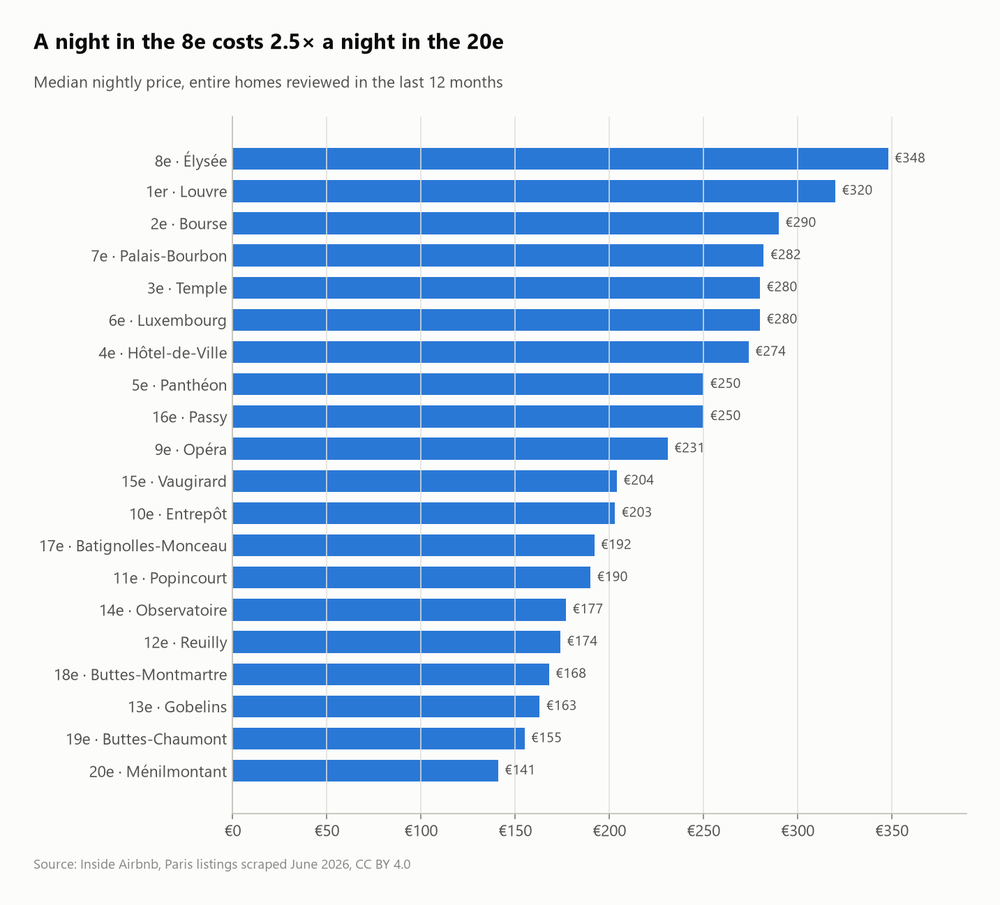
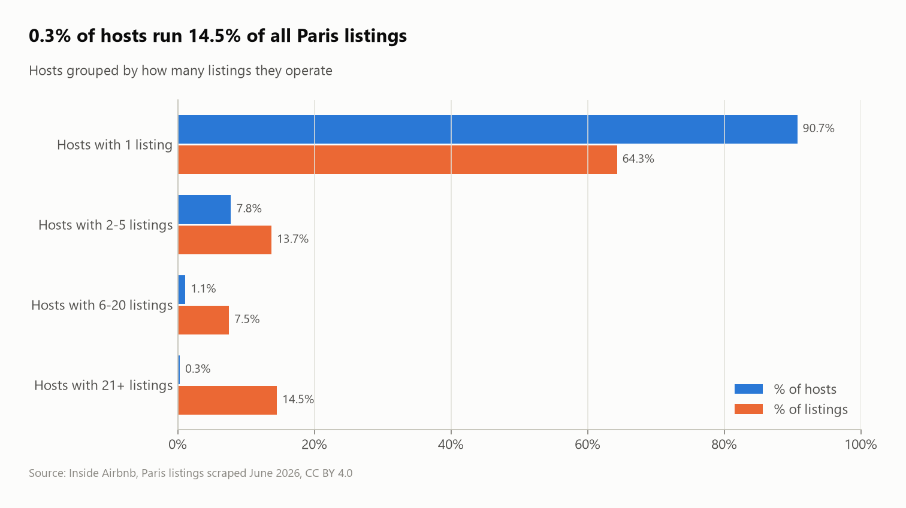
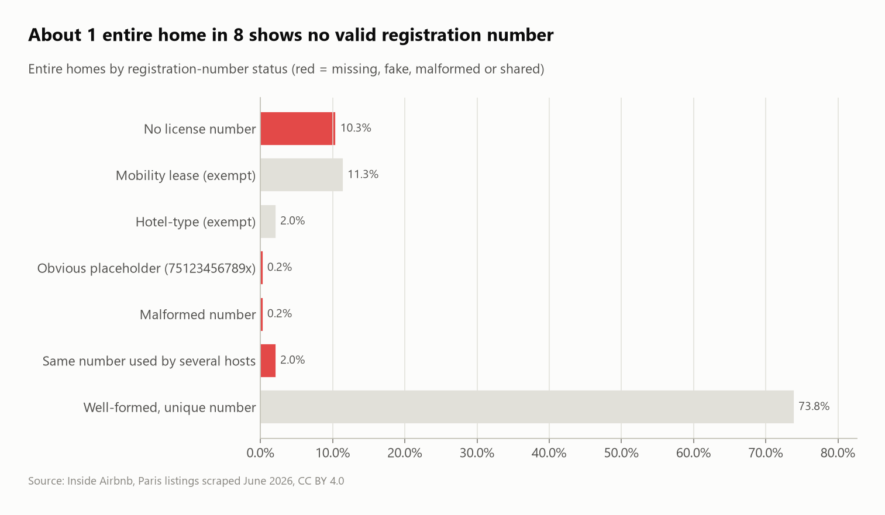

# Paris Airbnb: prices, professional hosts and license compliance

SQL analysis of **77,679 Paris Airbnb listings** (Inside Airbnb snapshot, June 2026): what a night costs in each arrondissement, how much of the market belongs to professional operators, and whether listings display a valid city registration number.



## Questions
1. How many listings are actually active?
2. What does a night cost by arrondissement and room type?
3. Is Airbnb in Paris run by residents or by professionals?
4. Do listings show a valid Paris registration number (required for short-term rentals)?
5. How much do listings earn?

## Key findings
- **Only 53.2% of listings are active** (reviewed in the last 12 months). 29,277 have no bookable price at all.
- **89.2% are entire homes,** with a median of **€213 per night**.
- **The 8e (Élysée) is 2.5× the price of the 20e (Ménilmontant):** €348 against €141 per night for an entire home. Ratings barely change (4.70–4.80), so price follows location, not quality.
- **Professionalization:** 90.7% of hosts have a single listing, but **187 operators with 21+ listings (0.3% of hosts) control 14.5% of all listings.** The largest, Blueground, runs 754.
- **About 1 entire home in 8 (12.7%) has no valid registration number:**
  - 10.3% show none at all;
  - **172 use an obvious placeholder** (`7512345678900`, shared by **98 different hosts**);
  - 1,411 share one number between several hosts.
- **A typical active entire home is booked about 94 nights a year** for about **€20,175** (Inside Airbnb's estimate). The top 10% earn €77,550 or more.

| Host concentration | Registration numbers |
|---|---|
|  |  |

## SQL techniques
- Mapping table built with **`VALUES`** (arrondissement names → numbers), `LEFT JOIN` enrichment
- Price parsing from text (`replace` + `CAST`), regular expressions (`regexp_matches`) for **license validation**
- **Detecting reused identifiers:** `count(DISTINCT host_id)` per license number, joined back to each listing
- Bucketing with `CASE`, share-of-total windows, `median` and `quantile_cont`

## Dataset
| | |
|---|---|
| Source | [Inside Airbnb – Paris](https://insideairbnb.com/get-the-data/), detailed `listings.csv.gz`, scraped 17–29 June 2026 |
| Size | 77,679 listings × 90 columns |
| License | CC BY 4.0 |

> Occupancy and revenue are Inside Airbnb **estimates** (based on reviews), not booking data. This is a compliance *signal*: some exemptions are legitimate.

## Run it
```bash
pip install -r ../../requirements.txt
python run.py
```
