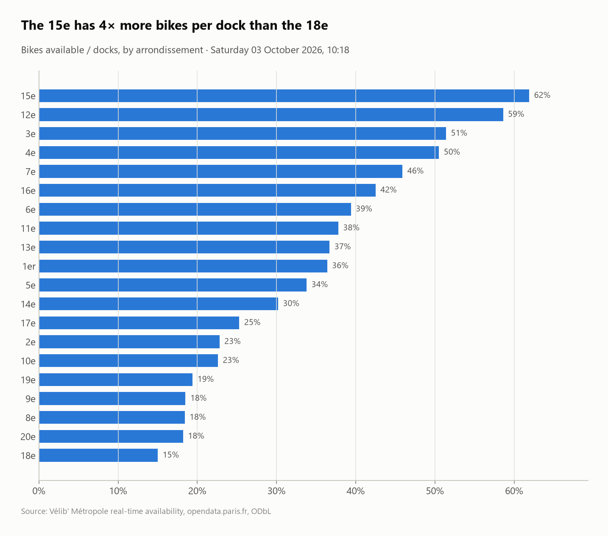

# Vélib' Paris: where are the bikes right now?

A real-time snapshot of the **Vélib' Métropole** bike-share network (1,519 stations, about 48,000 docks), analyzed with SQL: feed health, bikes available in Paris vs the suburbs, e-bike share, and which arrondissements fill up or run dry.


## Questions
1. How healthy is the live feed (closed stations, stations that stopped reporting)?
2. How many bikes are available, and how full are the stations, in Paris vs the suburbs?
3. Which arrondissements have too many bikes, and which too few?
4. Which suburban communes have the biggest networks?

## Key findings (snapshot: Saturday 3 October 2026, 10:18)
- **The feed contains ghosts:** 32 stations are out of service, and **12 haven't reported for over 24 hours, the oldest since February 2021**, yet they're still listed. All analysis uses the 1,487 active stations.
- **18,461 bikes were available** in 47,890 docks. Suburban stations were fuller (46% vs 35%) and held a higher share of e-bikes (47% vs 34%).
- **A 4× gap between arrondissements:** the **15e (62% full) and 12e (59%)** had bikes piling up, while the **18e (15%), 20e, 8e and 9e (all about 18%)** were running dry. More than 1 station in 8 was completely empty in the 9e (13%).
- **Boulogne-Billancourt** has the largest suburban network (30 stations) and was the fullest (67%).



## SQL techniques
- Parsing a `"lat, lon"` text field (`split_part` + `CAST`), deriving the arrondissement from the station code (`// 1000`)
- **Feed-health rules** relative to the snapshot time (`max(duedate) - INTERVAL 1 DAY`), not the clock, so results are reproducible
- Conditional aggregates (`count(*) FILTER`, `avg(bool::INT)` as a rate), Paris vs suburbs comparison with `GROUP BY CASE`

## Dataset
| | |
|---|---|
| Source | [Vélib' – Disponibilité en temps réel](https://opendata.paris.fr/explore/dataset/velib-disponibilite-en-temps-reel/) (Ville de Paris / Smovengo) |
| Size | 1,519 stations, one row each, refreshed every minute |
| License | ODbL |

> This is **one snapshot**. Running `run.py` in a fresh clone downloads a new one, so the numbers will differ. Delete `data/` to refresh. Collecting snapshots every 15 minutes into a table would turn this into a time-series project.

## Run it
```bash
pip install -r ../../requirements.txt
python run.py
```
