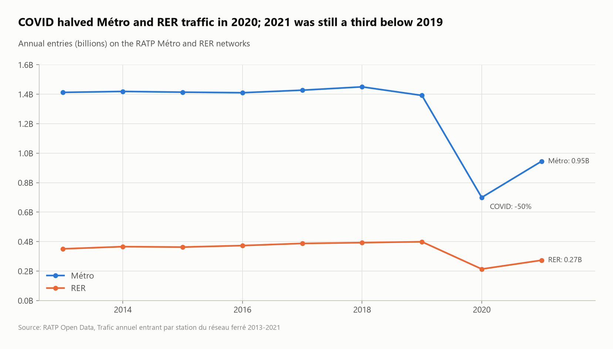
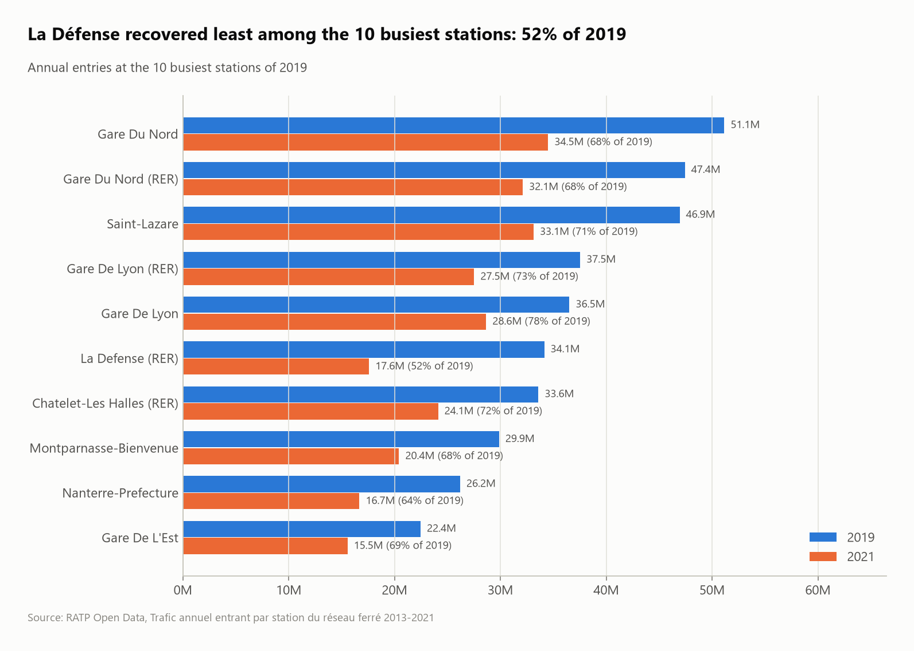
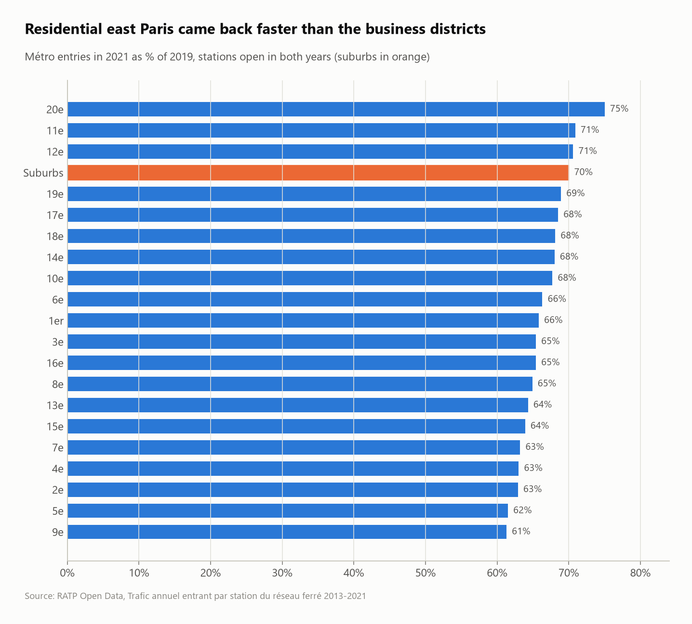

# RATP Métro & RER: nine years of station traffic (2013–2021)

Nine yearly RATP files (one per year, 371 stations each) stacked into a single table with SQL, to measure long-term traffic, the COVID collapse, and which parts of Paris came back first.



## Questions
1. How did Métro and RER traffic evolve from 2013 to 2021?
2. How much did COVID cut traffic, and how far had it recovered by 2021?
3. Did business districts and residential areas recover equally?
4. How concentrated is traffic, and do interchange stations draw more passengers?

## Key findings
- **A stable network, then two shocks:** Métro entries held at about 1.41–1.45 billion a year from 2013 to 2018. They dipped 4% in 2019, a year that ended with weeks of pension-reform strikes (though RER traffic still grew 1.6%), then **fell 49.7% in 2020**.
- **2021 was still a third below 2019:** the Métro was at **67.9%** of its 2019 level and the RER at 68.5%.
- **Business districts recovered least:** like-for-like, the **9e (Opéra / Saint-Lazare) reached only 61% of 2019**, against **75% in the 20e** and 70% in the suburbs. **La Défense RER** (Europe's largest business district) recovered least of the 10 busiest stations, at **52%**.
- **Gare du Nord was the busiest station in 7 of the 9 years** (Saint-Lazare took the top spot in 2018 and 2020). In 2019 it had 51.1M Métro entries plus 47.4M on the RER.
- **10% of stations carry about a third of all Métro traffic,** steady at 32–34% every year.
- **Interchanges matter:** a 3-line station draws a median of 9.0M entries a year, against 3.0M for a single-line station.

| Busiest stations | Recovery by area |
|---|---|
|  |  |

## Data pitfalls handled
- **New stations distort "recovery":** Pont Cardinet (17e) and Clichy–Saint-Ouen opened with the Line 14 extension in December 2020. Counting them would have pushed the 17e from 68.5% to 76.1% recovery, so area comparisons only use stations open in both years.
- **Station openings and closures distort rankings:** Mairie de Montrouge "grows 135%" from 2013 to 2019 only because the 2013 file footnotes it (`**`), most likely a partial first year. `rank_movers.csv` should be read with that in mind.

## SQL techniques
- **Multi-file ingestion** with a glob (`ratp_traffic_*.csv`), `union_by_name`, and the year parsed from the `filename` column
- `lag()` partitioned by network for YoY, **`dense_rank()` per year** for ranking moves, `percent_rank()` for concentration
- Pivot with `FILTER`, `QUALIFY` for top-N, like-for-like comparison via `HAVING` on both years
- Boolean arithmetic to count lines served (`(col IS NOT NULL)::INT + ...`)

## Dataset
| | |
|---|---|
| Source | [RATP Open Data – Trafic annuel entrant par station du réseau ferré](https://data.ratp.fr/explore/?q=trafic+annuel) (9 datasets, 2013–2021) |
| Size | 3,325 rows (369–371 stations × 9 years) |
| License | Licence Ouverte / ODbL (RATP Open Data) |

## Run it
```bash
pip install -r ../../requirements.txt
python run.py
```
