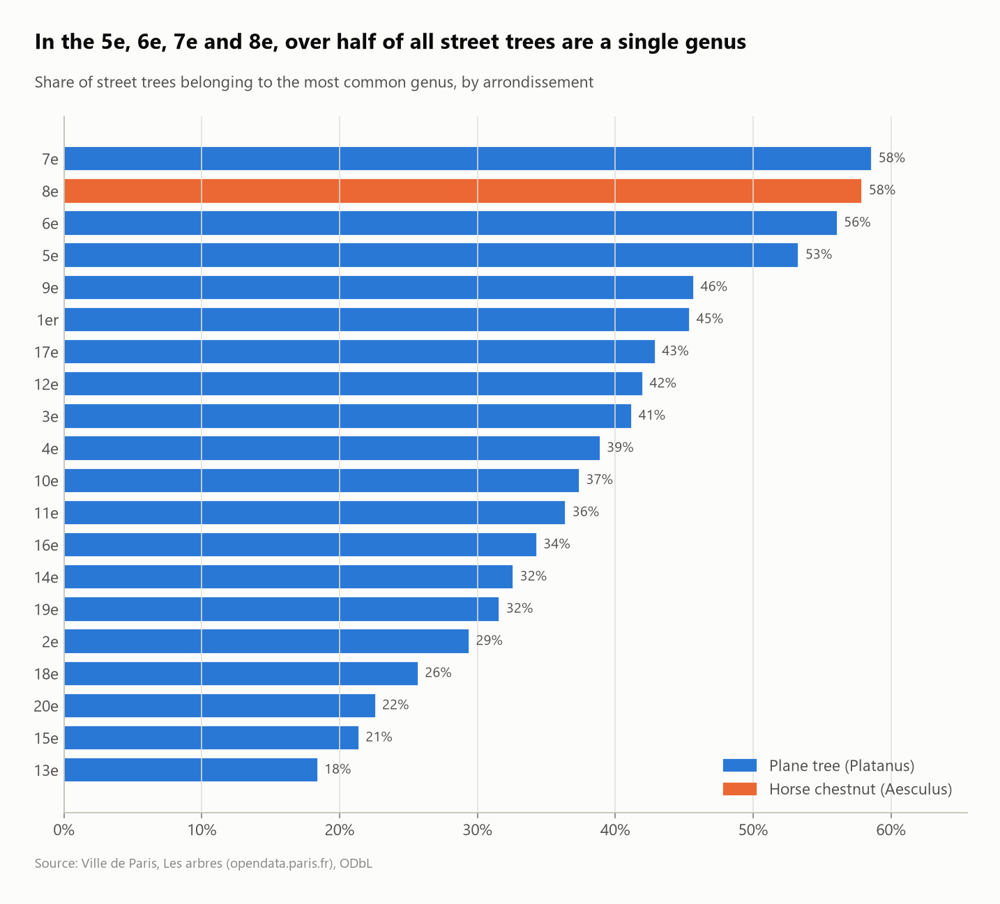
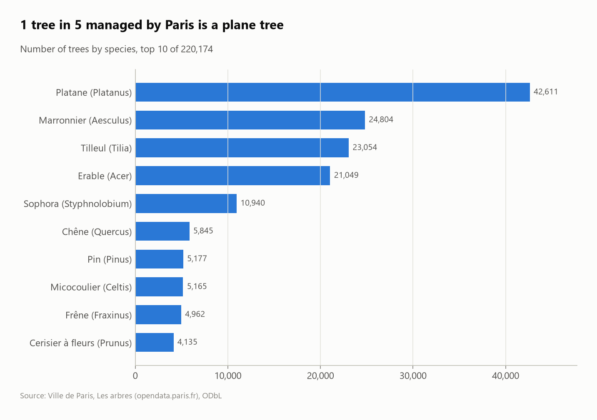
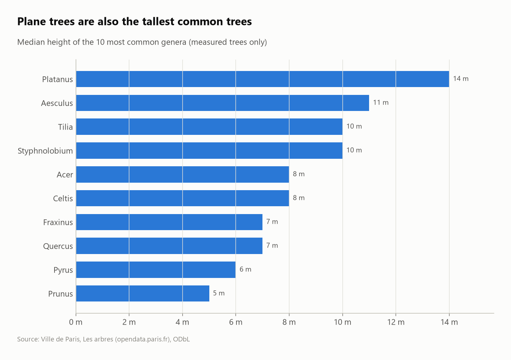

# The trees of Paris: species, monoculture risk and data quality

An SQL analysis of the City of Paris tree inventory: **220,174 trees** in streets, parks, cemeteries and schools. It covers what grows where, how dependent each district is on a single species, how big the trees get, and how reliable the measurements are.



## Questions
1. How reliable is the inventory (missing and impossible measurements)?
2. What are the most common trees?
3. How diverse are street trees in each arrondissement? (A single dominant genus is a disease risk.)
4. How tall do the common genera grow, and which trees are officially "remarkable"?

## Key findings
- **Measurements need cleaning:**
  - **19,987 trees have a height of 0** and 16,909 a circumference of 0. These are "not measured", stored as zero, so they're converted to `NULL`.
  - A few values are physically impossible (a **112 m** tree), so heights above 45 m and circumferences above 7 m are excluded.
  - 3,754 trees have no species.
- **The plane tree is Paris's tree:** 42,611 trees, **19.7% of the inventory**, followed by horse chestnut (11.5%), lime (10.7%) and maple (9.7%).
- **Monoculture risk in the center:** in the 5e, 6e and 7e, **over half of street trees are plane trees**. The 8e is the exception, dominated by **horse chestnuts (57.8%)**. The 13e (18%) and 15e (21%) are the most diverse, with 55–65 genera on their streets.
- **Plane trees are also the tallest common trees:** median height 14 m (top 10% at 20 m). Of the **182 "remarkable" trees, 44 are plane trees,** with a median height of 30 m.
- **A young urban forest:** about half of street and park trees are classified young, and only 3.4% of street trees are mature.

| Most common species | Height by genus |
|---|---|
|  |  |

## SQL techniques
- **Cleaning in the model:** sentinel zeros → `NULL`, plausibility ranges with `CASE ... BETWEEN`, an ambiguous category (`Jeune (arbre)Adulte`) normalized explicitly
- Parsing `"PARIS 13E ARRDT"` with `regexp_extract`, zoning with `LIKE`
- **Top-1 per group plus group totals in one pass:** `row_number()` and `sum()`/`count()` window functions partitioned by arrondissement
- `count(*) FILTER`, `quantile_cont`, share-of-total windows

## Dataset
| | |
|---|---|
| Source | [Les arbres – Ville de Paris](https://opendata.paris.fr/explore/dataset/les-arbres/) |
| Size | 220,174 trees × 16 columns |
| License | ODbL |

## Run it
```bash
pip install -r ../../requirements.txt
python run.py
```
