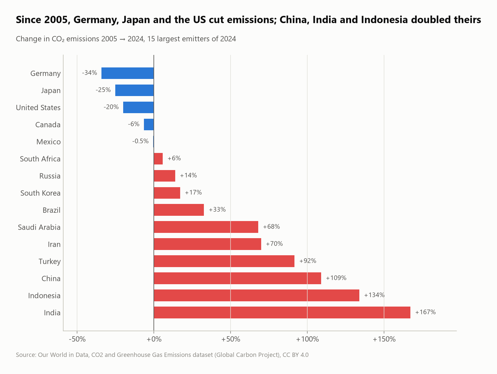
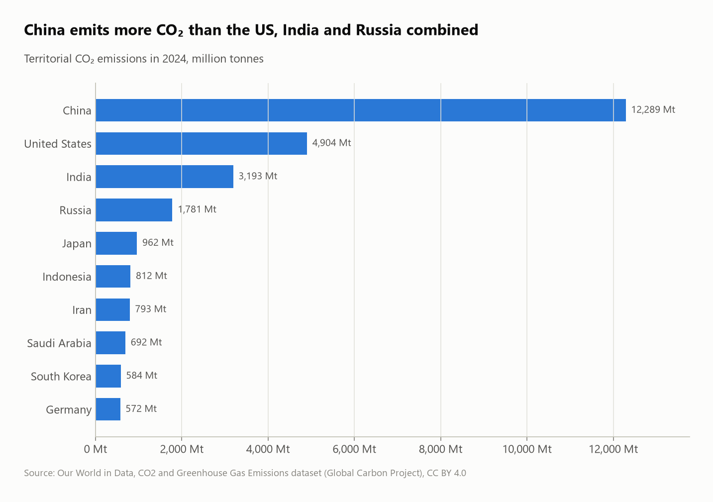
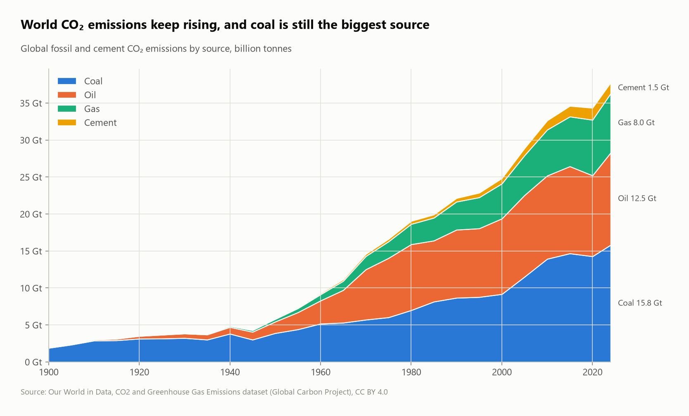

# CO₂ emissions: who emits, who cut, who is responsible

275 years of national CO₂ data (Our World in Data / Global Carbon Project, 1750–2024) analyzed with SQL: the biggest emitters today, historical responsibility, who cut and who grew since 2005, and emissions "offshored" through trade.



## Questions
1. How do you avoid double counting when countries and regions share one table?
2. Who are the largest emitters, in total and per person?
3. Who is historically responsible (cumulative emissions)?
4. Who cut emissions since 2005, and who grew?
5. Where do world emissions come from (coal, oil, gas, cement)?
6. Which countries "import" CO₂ through the goods they consume?

## Key findings
- **The grain trap:** the file mixes 218 countries with 36 aggregates (World, continents, income groups). **Summing every 2024 row gives 245,672 Mt, 6.4× the real world total (38,599 Mt).** Countries alone sum to 37,398 Mt. The 1,201 Mt gap is exactly international shipping (623 Mt), international aviation (569 Mt) and Kosovo (8 Mt, which has no ISO code).
- **China emitted 12,289 Mt in 2024, 31.8% of the world** and more than the US, India and Russia combined (9,878 Mt). Per person, though, a US resident (14.2 t) emits 6.5× an Indian (2.2 t).
- **Historical responsibility is different:** the **US accounts for 24.1%** of cumulative national emissions since 1750, China 15.8%, and the UK (4.4%) still more than India (3.7%).
- **Since 2005, Germany (−34%), Japan (−25%) and the US (−20%) cut emissions,** while **India (+167%), Indonesia (+134%) and China (+109%) more than doubled theirs.**
- **Coal is still the largest source:** 15.8 Gt in 2024, ahead of oil (12.5 Gt) and gas (8.0 Gt). World emissions have grown in every decade since 1945.
- **Offshored emissions (2023):** counting the CO₂ in imported goods, the **UK's footprint is 58% higher** than its territorial emissions, and France's 51% higher. China's is 11% lower: it exports emissions.

| Largest emitters | World emissions by fuel |
|---|---|
|  |  |

## SQL techniques
- **Grain control:** separating entities from aggregates (`iso_code NOT LIKE 'OWID%'`) and proving the overcount with scalar subqueries
- Pivot-by-year with `FILTER`, share-of-world via a scalar subquery, `QUALIFY row_number()` for top-N
- **Latest available year per country** with `QUALIFY year = max(year) OVER (PARTITION BY country)`
- Time sampling with modulo (`year % 5 = 0`)

## Dataset
| | |
|---|---|
| Source | [Our World in Data – CO₂ and Greenhouse Gas Emissions](https://github.com/owid/co2-data) (based on the Global Carbon Project) |
| Size | about 50,000 rows × 79 columns, 1750–2024 |
| License | CC BY 4.0 |

## Run it
```bash
pip install -r ../../requirements.txt
python run.py
```
