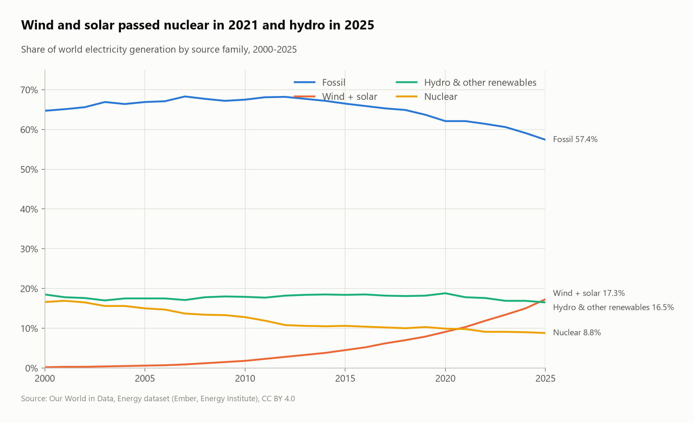
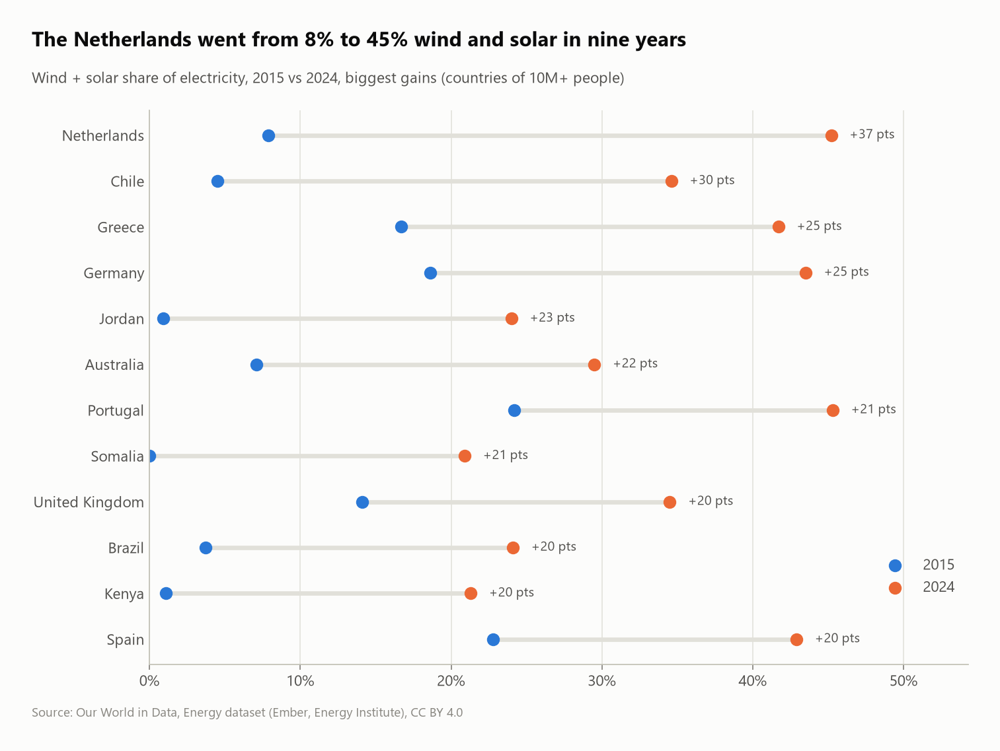
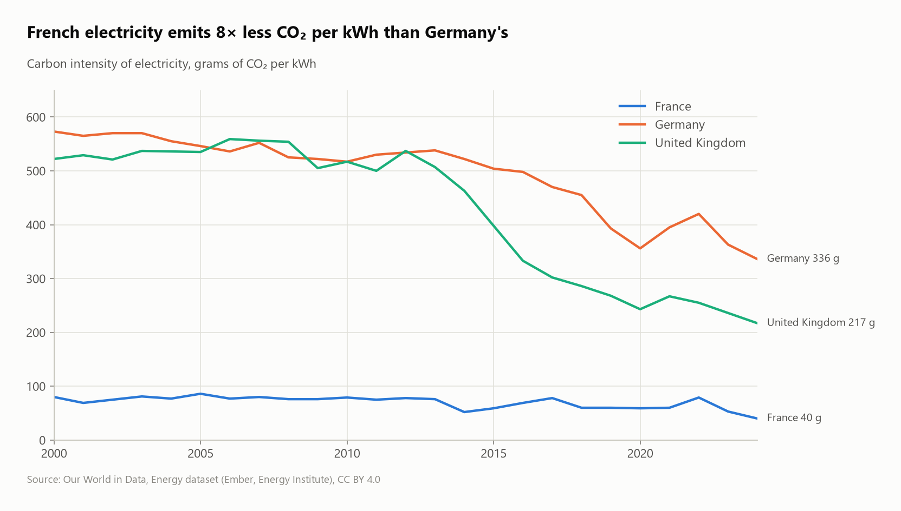

# The energy transition: how the world's electricity is changing

An SQL analysis of the world's electricity mix from 2000 to 2025 (Our World in Data / Ember): the rise of wind and solar, the countries moving fastest, the exit from coal, and why French electricity is so low-carbon.



## Questions
1. How has the world electricity mix changed since 2000?
2. When did wind and solar overtake nuclear and hydro?
3. Which countries added wind and solar fastest, and which left coal?
4. Which large countries have the cleanest electricity?
5. How does France compare with Germany and the UK?

## Key findings
- **Fossil fuels still make 57.4% of world electricity (2025),** down from a 68.3% peak in 2007.
- **Three milestones:** wind + solar passed **nuclear in 2021** and **hydro + other renewables in 2025**, at 17.3% of generation. In 2025 **solar (8.7%) overtook wind (8.5%)** for the first time.
- **The Netherlands moved fastest:** wind + solar rose from 8% to 45% of its electricity between 2015 and 2024 (+37 points), ahead of Chile (+30) and Greece and Germany (+25).
- **Coal exits:** the **UK went from 28.2% coal power in 2010 to 0.7%** in 2024, Greece from 54% to 6%, Denmark from 44% to 5%. Poland is still at 54%.
- **France has one of the cleanest grids among large countries:** 94.9% low-carbon (mostly nuclear, 27% renewables) and **40 g CO₂/kWh, 8× less than Germany (336 g)** and 5× less than the UK (217 g). Among countries of 10M+ people, only Sweden (98.8%) and a few hydro-powered countries (DR Congo, Ethiopia, Nepal, Uganda, Malawi) do better.
- **The UK cut its electricity's carbon intensity by 58% since 2000** (522 → 217 g/kWh), mostly from 2013 onwards.

| Fastest wind + solar growth | France vs neighbors |
|---|---|
|  |  |

## SQL techniques
- **`UNPIVOT`** of 8 wide `*_share_elec` columns into a long `(country, year, source, share)` table, then `FILTER` aggregates to regroup sources into families
- `lag()` partitioned by source for year-over-year changes in percentage points
- Two-year comparisons with `max(...) FILTER (WHERE year = ...)` and `HAVING` thresholds
- Population filter through a subquery (`country IN (SELECT ...)`)

## Dataset
| | |
|---|---|
| Source | [Our World in Data – Energy dataset](https://github.com/owid/energy-data) (Ember, Energy Institute Statistical Review) |
| Size | about 23,000 rows × 130 columns, 1900–2025 |
| License | CC BY 4.0 |

> 2025 only covers 90 countries, so country comparisons use 2024 and the World series runs to 2025.

## Run it
```bash
pip install -r ../../requirements.txt
python run.py
```
