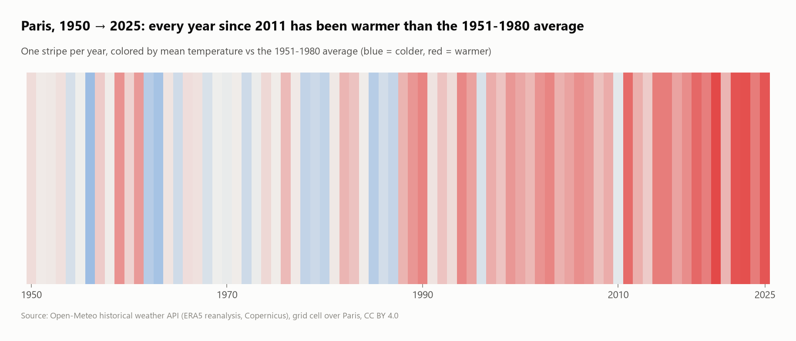
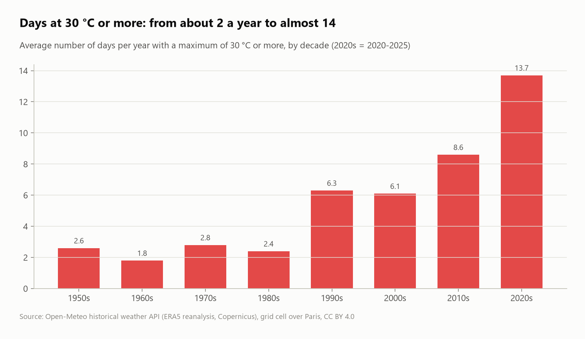
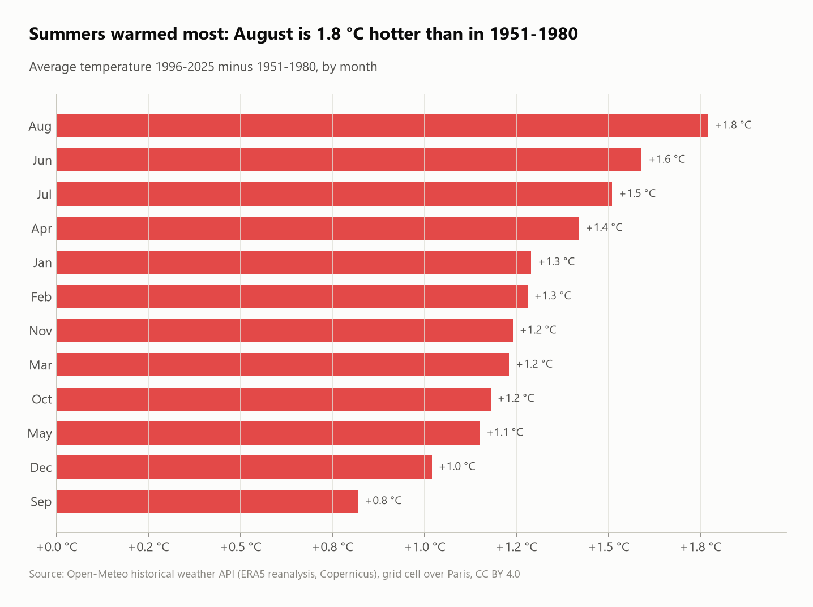

# Paris climate 1950–2025: 76 years of daily weather

**27,759 days** of Paris weather (Open-Meteo historical API, ERA5 reanalysis) analyzed with SQL: warming rate, anomalies against the 1951–1980 climate, heat waves, frost and tropical nights.



## Questions
1. Is the series complete?
2. How fast is Paris warming, and is it accelerating?
3. How have hot days, frost days and tropical nights changed per decade?
4. Which seasons warmed most?
5. Which were the hottest days and the warmest years?

## Key findings
- **Complete series:** 27,759 days from 1 January 1950 to 31 December 2025, with no missing values.
- **Paris warmed about 0.27 °C per decade since 1950, and 0.42 °C per decade since 1980** (least-squares slope), so warming is accelerating. The 10-year mean rose from 10.7 °C to 12.4 °C.
- **All 10 warmest years are 2011 or later** (2020 the warmest, at 13.0 °C), and **every year since 2011 has been above the 1951–1980 average**.
- **Hot days (30 °C or more) went from about 2 a year to 13.7** (1950s → 2020s). Frost days fell from 55 to 30 a year, and tropical nights (minimum of 20 °C or more) became five times more common.
- **All 10 hottest days were in 2003 or later.** The peak is **25 July 2019 at 40.7 °C** in this dataset. (The official Paris-Montsouris station recorded 42.6 °C that day; reanalysis smooths extremes.)
- **Summers warmed most:** August is +1.8 °C and June +1.6 °C warmer than in 1951–1980, against +0.8 °C for September.

| Hot days per decade | Warming by month |
|---|---|
|  |  |

## SQL techniques
- Reading a CSV with a metadata preamble (`skip = 3`) and unit-suffixed column names
- **Baseline table** (1951–1980 monthly normals) joined back for anomalies
- **Linear regression in SQL:** `regr_slope` and `regr_r2`, including a `FILTER`ed slope since 1980
- 10-year rolling mean with a window frame, decade bucketing (`year // 10 * 10`), threshold counts with `count(*) FILTER`, top-N with `rank()` + `QUALIFY`

## Dataset
| | |
|---|---|
| Source | [Open-Meteo Historical Weather API](https://open-meteo.com/en/docs/historical-weather-api) (ERA5 / ERA5-Land reanalysis, Copernicus) |
| Location | Grid cell around 48.89° N, 2.29° E (Paris) |
| License | CC BY 4.0 |

> Reanalysis is a modeled grid average, not a single station. It's ideal for consistent long-term trends, but it smooths record extremes.

## Run it
```bash
pip install -r ../../requirements.txt
python run.py
```
