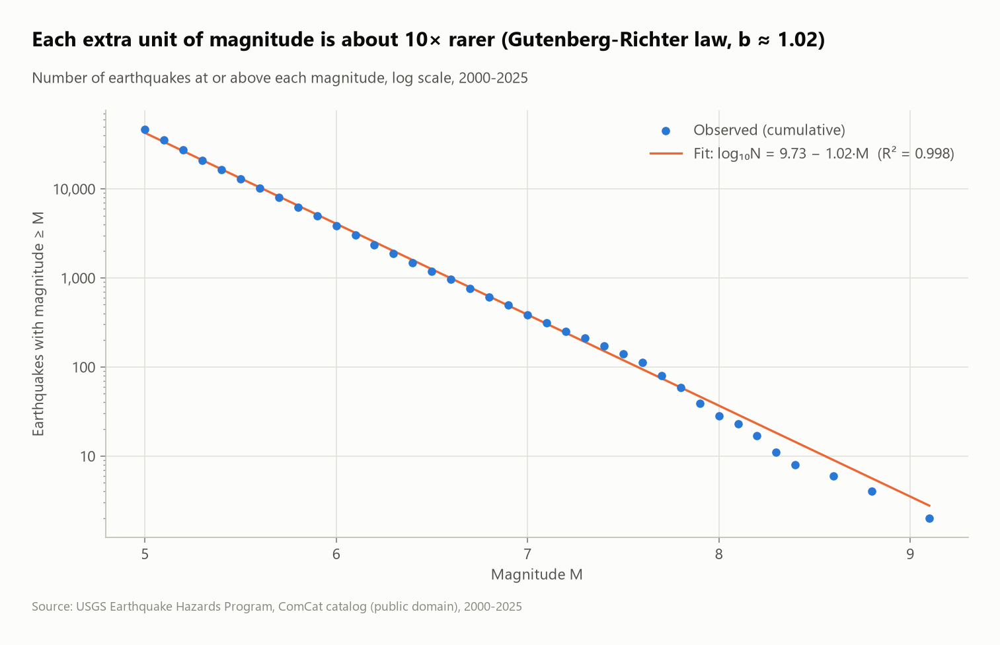
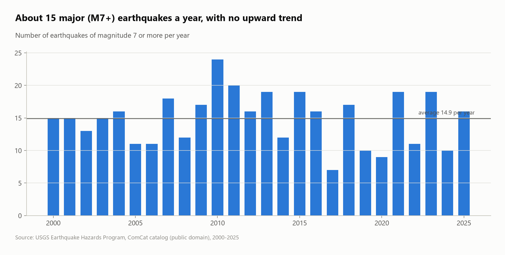
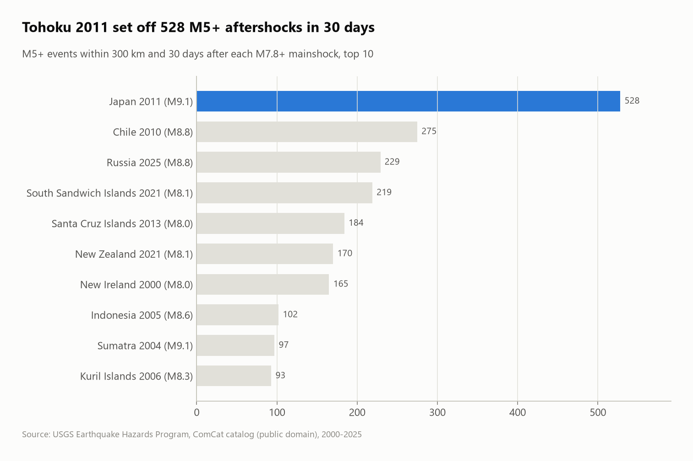

# Earthquakes 2000–2025: where, how often, how big

Every **magnitude 5+ event** in the USGS catalog from 2000 to 2025 (26 yearly files, 46,522 events), analyzed with SQL: what the catalog really contains, where the large quakes strike, how depth relates to size, a **Gutenberg–Richter law fitted entirely in SQL**, and spatio-temporal SQL: aftershock sequences (range self-join), foreshocks (`ASOF JOIN`), sliding 365-day windows and gaps-and-islands on a generated calendar.


## Questions
1. Is everything in an "earthquake catalog" an earthquake?
2. Where do the strong (M6+) earthquakes happen?
3. Is the planet becoming more active?
4. Does the frequency–magnitude relationship (Gutenberg–Richter law) hold, and what is its b-value?
5. How regular are major (M7+) earthquakes?
6. How many aftershocks follow the largest earthquakes? (range self-join in time and space)
7. Is a big earthquake usually preceded by another one nearby? (`ASOF JOIN`)
8. What were the busiest and quietest 12 months? (`RANGE` window over an `INTERVAL`)
9. What is the longest run of months with, and without, an M7+? (gaps and islands)

## Key findings
- **Not every event is an earthquake:** the catalog contains 55 volcanic eruptions, 1 landslide and **4 nuclear explosions** (North Korea's tests of 2013, 2016 ×2 and 2017, up to magnitude 6.3). They're excluded, leaving 46,462 earthquakes.
- **Gutenberg–Richter holds almost perfectly:** fitting `log10(N ≥ M) = a − b·M` gives **b = 1.021 with R² = 0.998**, close to the textbook value of 1. Each extra unit of magnitude is about 10× rarer.
- **No upward trend:** about **15 M7+ earthquakes a year** (slope −0.05 a year, correlation −0.09). 2011 (Tohoku and its aftershocks) had the most M6+ events (207).
- **Indonesia has the most M6+ earthquakes (410),** ahead of Papua New Guinea (286) and Japan (275). The 3,874 M6+ events draw the Pacific Ring of Fire.
- **The biggest:** Sumatra 2004 and Tohoku 2011 (both 9.1), then Maule, Chile 2010 and Kamchatka 2025 (both 8.8).
- **83% of quakes are shallow (< 70 km),** but deep events (300 km or more) are slightly larger on average (M5.54 vs 5.34). M7+ quakes come every 15.5 days at the median, and 28 times two struck on the same day.

- **Aftershocks:** Tohoku 2011 (M9.1) was followed by **528 M5+ events within 300 km in 30 days**, 290 of them on the first day and 54 of them M6+. Maule 2010 (275) and Kamchatka 2025 (229) come next. Sumatra 2004 shows only 97: its rupture ran 1,300 km, far beyond a 300 km radius from the epicenter.
- **Big quakes rarely come alone:** **53.5% of the 387 M7+ earthquakes** came within 7 days of an earlier M5+ in the same region (105 within a day). The median gap is 5.4 days (`ASOF JOIN` on region and time).
- **The busiest 12 months** (Apr 2010 – Apr 2011, covering Maule's aftershocks and Tohoku) had **219 M6+ quakes**. The quietest (Feb 2024 – Feb 2025) had 92.
- **Streaks:** the longest run of consecutive months with an M7+ is **10 months** (May 2003 – Feb 2004). The longest run without one is 5 months (Feb – Jun 2017).

| Gutenberg–Richter law | M7+ per year |
|---|---|
|  |  |



## SQL techniques
- **Multi-file ingestion** (26 CSVs via a glob) and timezone handling (`timezone('UTC', ...)`)
- Text parsing with `split_part` and `regexp_replace` (`"2010 Maule, Chile Earthquake"` → `Chile`)
- **Statistics in SQL:** reverse cumulative counts with `sum() OVER (ORDER BY m DESC ...)`, then `regr_slope`, `regr_intercept` and `regr_r2` on `log10` to fit the b-value
- `lag()` for waiting times between events, `string_agg(DISTINCT ... ORDER BY ...)` for a readable, deterministic audit column
- **Constraints:** `PRIMARY KEY (id)` and `CHECK`s on magnitude, coordinates and depth
- **Spatio-temporal range self-join:** a time window plus a latitude band as a cheap pre-filter, then an exact **haversine macro**; `NOT EXISTS` to keep only true mainshocks
- **`ASOF JOIN`:** the latest earlier event in the same region, for each M7+
- **`RANGE BETWEEN INTERVAL 365 DAY PRECEDING`** sliding windows, with the "full windows only" filter applied *after* the window (a `WHERE` in the same `SELECT` would remove rows before they are counted)
- **Gaps and islands** on a calendar generated with `range()`, so months with no event exist as rows: `row_number()` minus `row_number() OVER (PARTITION BY flag)`

## Dataset
| | |
|---|---|
| Source | [USGS Earthquake Catalog (ComCat) API](https://earthquake.usgs.gov/fdsnws/event/1/), `minmagnitude=5`, one request per year |
| Size | 46,522 events × 22 columns |
| License | Public domain (U.S. Government) |

## Run it
```bash
pip install -r ../../requirements.txt
python run.py
```
