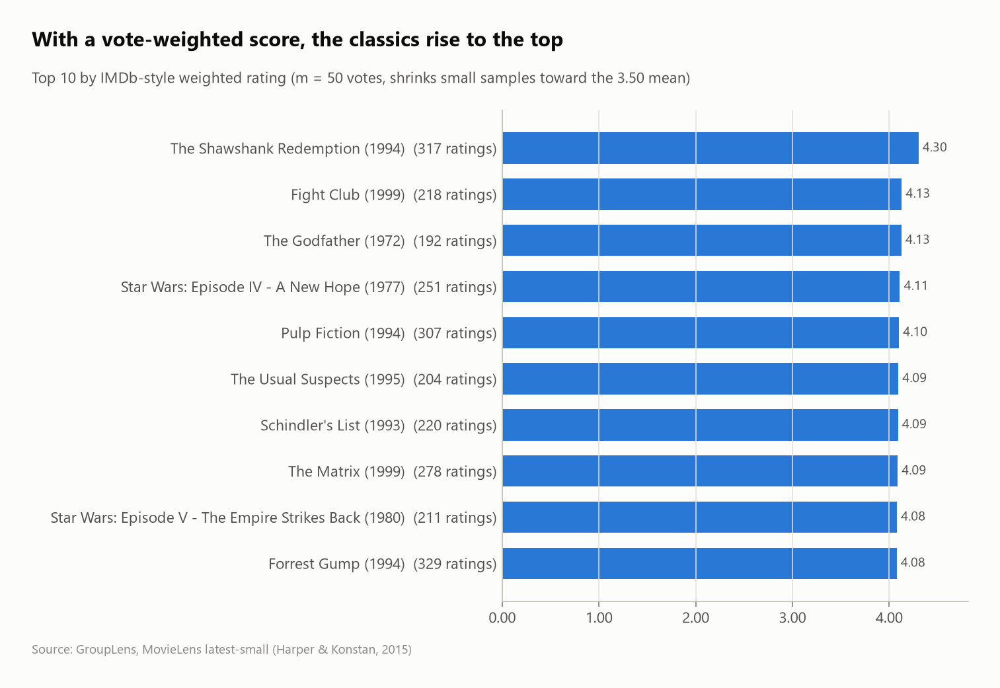
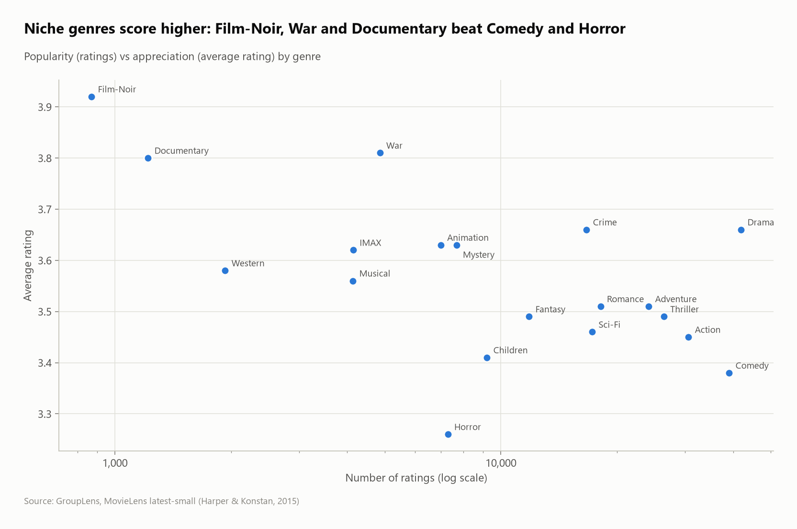
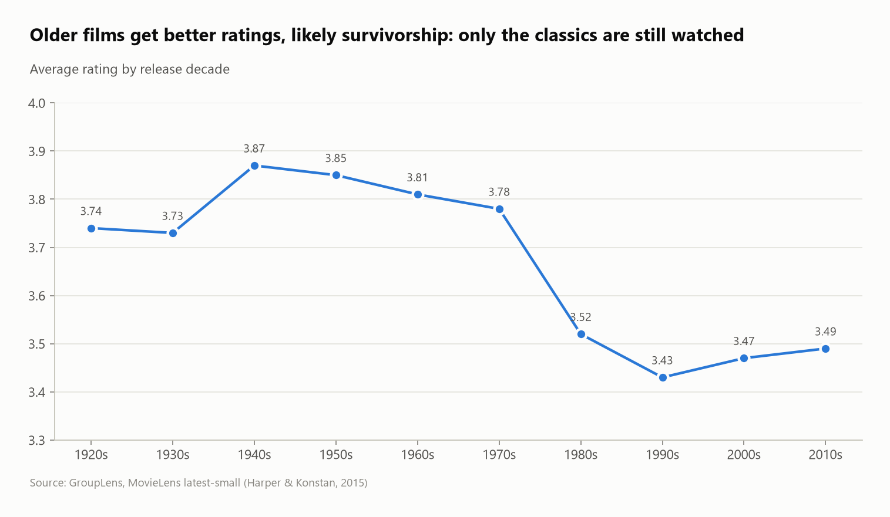

# MovieLens: what makes a movie "best rated"?

**100,836 ratings** by 610 users on 9,742 movies (GroupLens MovieLens, 1996–2018), analyzed with SQL: why a plain average is a bad ranking, an IMDb-style weighted score, genre popularity vs appreciation, and how concentrated user activity is.



## Questions
1. How sparse is the rating matrix?
2. Why does ranking by average rating fail, and how do you fix it?
3. Which genres are popular, and which are best rated?
4. Are older movies rated better?
5. How much do the most active users weigh?

## Key findings
- **A very sparse matrix:** only **1.7%** of user × movie pairs have a rating, and **62.5% of movies have fewer than 5 ratings**.
- **Plain averages lie:** **296 movies have a perfect 5.0 average,** all from just 1 or 2 ratings. The naive "top 10" is made of those.
- **The weighted rating fixes it:** `WR = v/(v+m)·R + m/(v+m)·C` (with m = 50 votes, C = 3.50) pulls small samples toward the global mean. The top becomes **The Shawshank Redemption (4.30, 317 ratings)**, then Fight Club and The Godfather.
- **Popular ≠ best rated:** Drama and Comedy collect the most ratings, but **Film-Noir (3.92), War (3.81) and Documentary (3.80)** score highest. Horror is lowest (3.26).
- **Older films score higher:** 1940s–1970s releases average 3.78–3.87, against 3.43–3.52 since the 1980s. Survivorship is the likely reason: old films still watched today are the classics.
- **Users rate in whole stars:** 69.9% of ratings are whole numbers, and 4.0 is the most common (26.6%).
- **The top 10% of users give 47.7% of all ratings** (between 403 and 2,698 ratings each).

| Genres: popularity vs rating | Rating by release decade |
|---|---|
|  |  |

## SQL techniques
- **Exploding a multi-valued column:** `unnest(string_split(genres, '|'))` into a bridge table
- Year extraction from titles with `regexp_extract`, Unix timestamps with `to_timestamp`
- **Bayesian / IMDb weighted rating** with a parameters CTE and `CROSS JOIN`
- Matrix sparsity, `ntile(10)` user deciles, share-of-total windows

## Dataset
| | |
|---|---|
| Source | [GroupLens – MovieLens latest-small](https://grouplens.org/datasets/movielens/latest/) (Harper & Konstan, 2015) |
| Size | 100,836 ratings, 3,683 tags, 9,742 movies, 610 users |
| License | Research use; the data is downloaded by `run.py`, not redistributed in this repo |

## Run it
```bash
pip install -r ../../requirements.txt
python run.py
```
