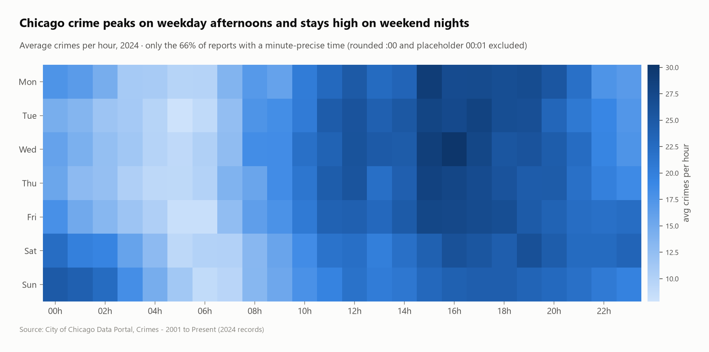
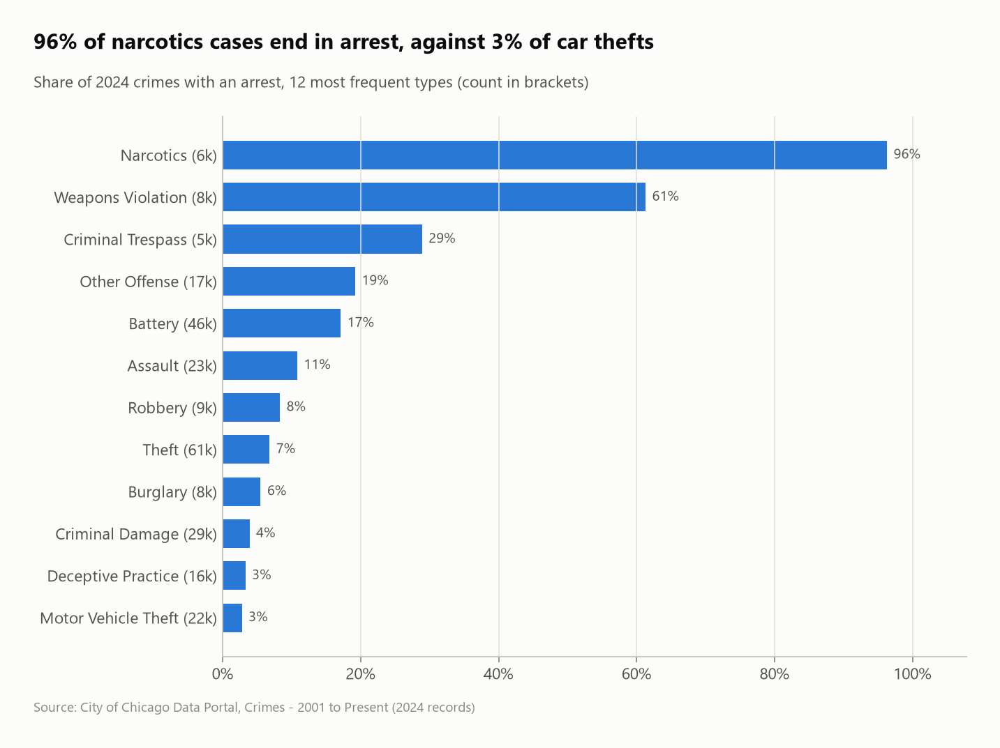
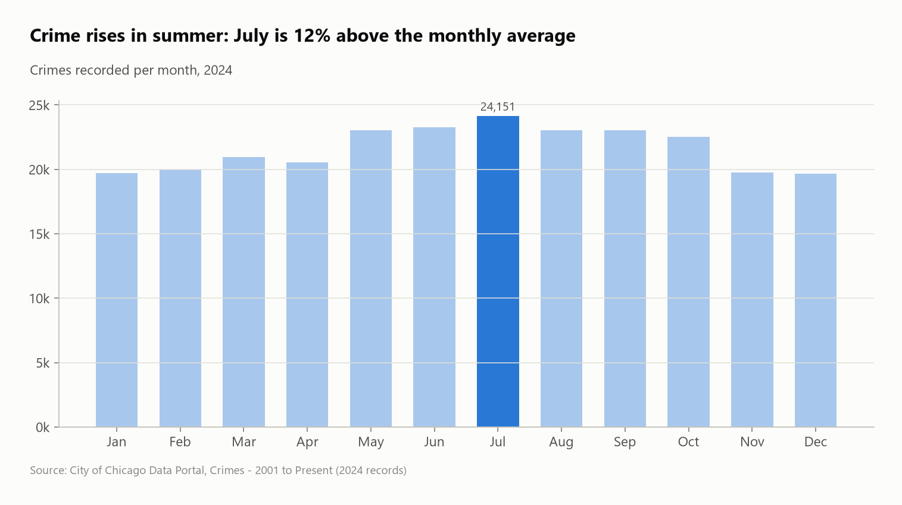

# Chicago crime 2024: what, when, where, and how reliable is the clock?

All **259,638 crimes** recorded in Chicago in 2024 (City of Chicago data portal), analyzed with SQL: crime types and arrest rates, seasonality, the weekly rhythm, and the community areas where crime concentrates. A large part of the work went into **finding the fake timestamps** hiding in the data.



## Questions
1. What crimes are most common, and how often do they lead to an arrest?
2. When does crime happen (season, weekday, hour)? Can the timestamps be trusted?
3. Where does crime concentrate?

## Key findings
- **Theft (23.3%) and battery (17.8%) are 41% of all crimes.** Only **13.8% of crimes lead to an arrest**, and 18.4% are domestic.
- **Arrest rates measure enforcement more than crime:** **96% of narcotics cases** and 61% of weapons violations end in arrest, because these crimes are usually discovered *by* the police. Only **3% of car thefts** and 4% of criminal damage cases do.
- **The timestamps hide placeholders:**
  - **9,443 crimes are logged at exactly 00:00**, 6,104 at 12:00 and 1,967 at 00:01. These are "time unknown" placeholders, mostly fraud and theft.
  - A third of all times are rounded to the hour, and the 1st of the month is over-represented too.
  - The hourly analysis therefore uses only the 66% of reports with a minute-precise time. Without that, the chart would show a fake midnight crime wave.
- **The real rhythm:** crime peaks on **weekday afternoons (15:00–17:00, about 30 crimes an hour)**, bottoms out around 05:00 (about 8), and weekend late nights are busier than weekday nights.
- **Summer peak:** **July is 11.6% above the monthly average,** and December 9.2% below.
- **Violence is concentrated:** of 597 homicides, **48% happened in just 10 of the 77 community areas.** Austin has the most crimes overall (5.0% of the city).

| Arrest rate by type | Seasonality |
|---|---|
|  |  |

## SQL techniques
- **A SQL macro** (`CREATE MACRO initcap`) built from list functions (`string_split`, `list_transform`, `list_aggregate`)
- **Data-quality forensics:** frequency of exact clock times to expose placeholder values, then filtering on `minute(...)`
- A **calendar table generated with `range()`** to divide by the true number of Mondays, Tuesdays… in 2024
- `avg(bool::INT)` rates, `rank()` + `QUALIFY`, `row_number()` for top-10 concentration, deviation from the mean with a window average

## Dataset
| | |
|---|---|
| Source | [City of Chicago – Crimes 2001 to Present](https://data.cityofchicago.org/Public-Safety/Crimes-2001-to-Present/ijzp-q8t2) (Socrata API, `year=2024`), plus [Community Areas](https://data.cityofchicago.org/d/igwz-8jzy) |
| Size | 259,638 crimes × 9 selected columns, 77 community areas |
| License | City of Chicago Data Portal terms of use (open data) |

> Counts aren't rates: without population figures per area, this project compares volumes, not risk per resident.

## Run it
```bash
pip install -r ../../requirements.txt
python run.py
```
