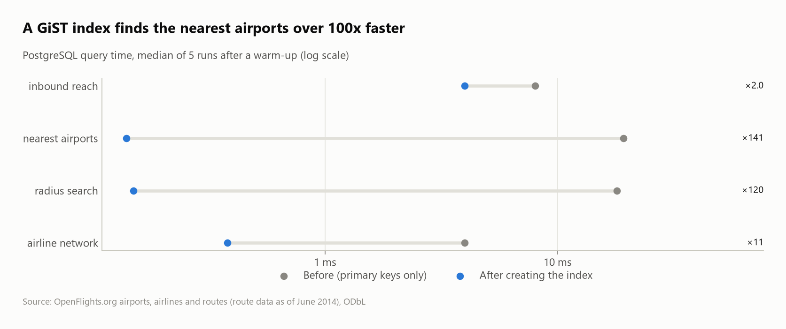

# The world's air network: hubs, airlines and reachability from Paris

The OpenFlights database (7,698 airports, 6,162 airlines, 67,663 routes) analyzed as a **graph in SQL**: the best-connected hubs, the largest airline networks, great-circle distances computed in SQL, a **recursive query** that measures how much of the world is reachable from Paris, and a **shortest-path algorithm (Bellman-Ford) written in SQL** that rebuilds the shortest itinerary to every airport. The graph is then copied into **PostgreSQL** to benchmark graph and geographic indexes.


## Questions
1. Can the data be trusted as-is?
2. Which airports and airlines have the largest networks?
3. What are the longest nonstop routes, and how long is a typical route?
4. How much of the world can you reach from Paris with 0, 1 or 2 connections?
5. What is the shortest flying route from Paris to anywhere, and how far off a straight line is it? (shortest paths in SQL)
6. What are the 3 biggest hubs of each major country? (`LATERAL`)
7. Which routes are flown in one direction only? (anti-join, 2-leg `EXISTS`)
8. **PostgreSQL:** which indexes serve graph traversal and "nearest airport" searches?

## Key findings
- **Corrupted records found:** 423 routes point to unknown airports. More subtly, **10 US airports had their city and country overwritten** with foreign ones: "Los Alamitos Army Air Field" (ICAO `KSLI`, California) is filed under Solwesi, Zambia, and NASA's Shuttle Landing Facility under Madagascar. Left in, they create a **16,082 km "domestic" Zambian flight**. They're detected by checking the ICAO code against the country (`K___`/`PA__` = United States) and excluded.
- **Top hubs (2014):** **Frankfurt (239 destinations), Paris-CDG (237) and Amsterdam (232).** CDG connects to the most countries of all: 105.
- **Ryanair had the most routes (2,484),** ahead of American (2,352) and United (2,178), with a similar median route length (about 1,400 km).
- **Most flights are short:** 61% of airport pairs are under 1,500 km. The longest nonstop route is **Sydney → Dallas (13,808 km)**.
- **Reachability from Paris (recursive CTE):**
  - **287 airports nonstop** (9% of airports with departures);
  - **61.5% with one connection**;
  - **89% with two connections**.
- **Domestic vs international:** 81% of US routes and 85% of Chinese routes are domestic, against 25% for France and 9% for Germany.
- **Shortest flying routes from Paris-CDG (Bellman-Ford in SQL, checked against a Python Dijkstra: same 3,164 airports, same distances):**

  | To | Shortest itinerary | Flown | Straight line | Detour |
  |---|---|---|---|---|
  | Auckland | CDG → NRT → AKL | 18,546 km | 18,541 km | 0.0% |
  | Sydney | CDG → SGN → SYD | 16,951 km | 16,944 km | 0.0% |
  | Easter Island | CDG → SCL → IPC | 15,425 km | 13,817 km | 11.6% |
  | Honolulu | CDG → MAN → YVR → HNL | 12,279 km | 11,958 km | 2.7% |
  | Anchorage | CDG → SEA → ANC | 10,375 km | 7,519 km | **38.0%** |
  | Svalbard | CDG → OSL → LYR | 3,370 km | 3,294 km | 2.3% |

  Two-stop trips are close to a straight line (median detour 1.8%). The detour grows with remoteness: the median is 8.9% at 4 legs and 32% at 8 legs.
- **London is a hub city, not a hub airport:** Heathrow, Gatwick and Stansted each serve 150–170 destinations, and 95%+ of them are international. Beijing's top 3 hubs are 47–64% domestic, and Atlanta, Chicago and Dallas are 71–74% domestic.
- **810 routes (2.2%) are flown one way only,** and 752 of them (93%) have a 2-leg way back: these are "triangle" routings.

| Paris nonstop network | Top hubs |
|---|---|
|  |  |

## PostgreSQL: index benchmarks
The graph (`airports`, `airlines`, `routes`, `edges` with primary, unique and foreign keys) is copied into PostgreSQL 18 (`sql/03_postgres_schema.sql`), and each query in `sql/04_index_benchmarks.sql` is timed before and after its index. The timing is the median of 5 `EXPLAIN ANALYZE` runs, the result must be identical both times, and the plans are in [`results/plans/`](results/plans).



| Query | Index | Before → after | Lesson |
|---|---|---|---|
| `nearest_airports`: 5 closest to the Eiffel Tower | GiST on `ll_to_earth(lat, lon)` (`earthdistance`) | 19 → 0.14 ms | k-nearest-neighbour: `ORDER BY point <-> target LIMIT 5` walks the index outward |
| `radius_search`: airports within 100 km of Frankfurt | same GiST index, `earth_box() @>` | 18 → 0.15 ms | bounding-box search in the index, then an exact distance filter |
| `airline_network`: one airline's 17 routes | B-tree on the foreign key `routes(airline_id)` | 4.0 → 0.38 ms | Postgres does not index foreign keys |
| `inbound_reach`: who can reach CDG in 2 flights | `(dst_id, src_id)` | 8.0 → 4.0 ms | the primary key `(src_id, dst_id)` serves the forward search (`outbound_reach`, 4.1 ms, no extra index) but not the reverse one: leftmost-prefix rule |

The dataset is small (37k edges), so absolute gains are milliseconds. The access paths in the plans are what carry over to large graphs.

## SQL techniques
- **`WITH RECURSIVE`** breadth-first search over an edge table, with `min(legs)` to keep the first time each airport is reached
- **A haversine macro** (`CREATE MACRO haversine_km`) for great-circle distances, using trig functions in SQL
- Headerless files with explicit schemas and `nullstr = '\N'`
- **Cross-field validation** (ICAO prefix vs country) to catch corrupted records, then `NOT IN` exclusion
- Graph metrics with `count(DISTINCT ...)` (out-degree, countries served), `DISTINCT` to collapse airline routes into airport pairs
- **Shortest paths in SQL:** a recursive CTE with `USING KEY` (DuckDB) acting as a per-airport dictionary, `recurring.` to read the best distance so far, and `arg_min()` to carry the itinerary list of the best path (Bellman-Ford, stops when no distance improves)
- **Enforced keys:** primary keys, `UNIQUE (iata)`, foreign keys from routes and edges to airports and airlines, `CHECK` on coordinates
- **`LATERAL`** top-3 per country; **anti-join** (`NOT EXISTS`) and a **2-leg `EXISTS`** for triangle routings
- **PostgreSQL:** recursive CTEs over a composite primary key, GiST k-nearest-neighbour and radius search (`cube` + `earthdistance`), foreign-key indexes

## Dataset
| | |
|---|---|
| Source | [OpenFlights.org data](https://openflights.org/data) (`airports.dat`, `airlines.dat`, `routes.dat`) |
| Size | 7,698 airports, 6,162 airlines, 67,663 routes |
| License | Open Database License (ODbL) |

> OpenFlights stopped updating routes in **June 2014**, so this is a historical snapshot of the network, not today's schedule.

## Run it
```bash
pip install -r ../../requirements.txt
python run.py          # download -> load -> analyze -> postgres benchmarks -> charts
```
The PostgreSQL step uses the server in `PG_DSN`. If that isn't set, it uses a local server on port 5433 (`docker compose up -d` from the repo root, or a PostgreSQL install, which the toolkit starts as a private cluster in `.pgdata/`). With no PostgreSQL at all, the step is skipped.
