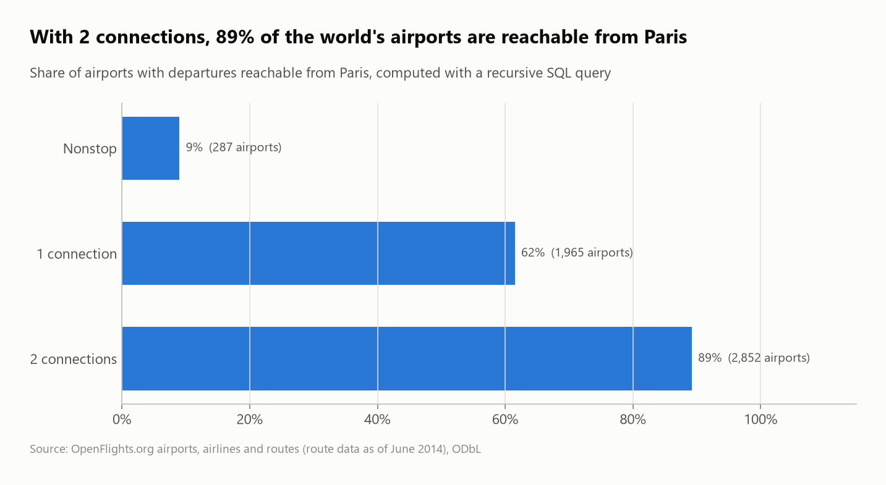
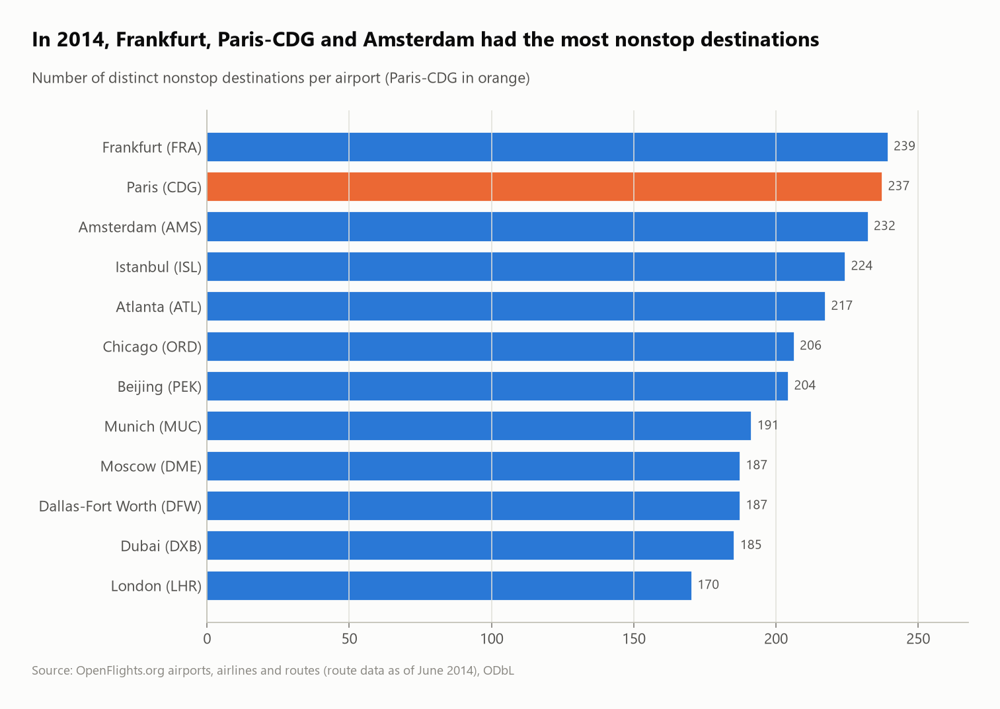

# The world's air network: hubs, airlines and reachability from Paris

The OpenFlights database (7,698 airports, 6,162 airlines, 67,663 routes) analyzed as a **graph in SQL**: the best-connected hubs, the largest airline networks, great-circle distances computed in SQL, and a **recursive query** that measures how much of the world is reachable from Paris.



## Questions
1. Can the data be trusted as-is?
2. Which airports and airlines have the largest networks?
3. What are the longest nonstop routes, and how long is a typical route?
4. How much of the world can you reach from Paris with 0, 1 or 2 connections?

## Key findings
- **Corrupted records found:** 423 routes point to unknown airports. More subtly, **10 US airports had their city and country overwritten** with foreign ones: "Los Alamitos Army Air Field" (ICAO `KSLI`, California) is filed under Solwesi, Zambia, and NASA's Shuttle Landing Facility under Madagascar. Left in, they create a **16,082 km "domestic" Zambian flight**. They're detected by checking the ICAO code against the country (`K___`/`PA__` = United States) and excluded.
- **Top hubs (2014):** **Frankfurt (239 destinations), Paris-CDG (237) and Amsterdam (232).** CDG connects to the most countries of all: 105.
- **Ryanair had the most routes (2,484),** ahead of American (2,352) and United (2,178), with a similar median route length (about 1,400 km).
- **Most flights are short:** 61% of airport pairs are under 1,500 km. The longest nonstop route is **Sydney → Dallas (13,808 km)**.
- **Reachability from Paris (recursive CTE):**
  - **287 airports nonstop** (9% of airports with departures);
  - **61.5% with one connection**;
  - **89% with two connections**.
- **Domestic vs international:** 81% of US routes and 85% of Chinese routes are domestic, against 25% for France and 9% for Germany.

| Paris nonstop network | Top hubs |
|---|---|
|  |  |

## SQL techniques
- **`WITH RECURSIVE`** breadth-first search over an edge table, with `min(legs)` to keep the first time each airport is reached
- **A haversine macro** (`CREATE MACRO haversine_km`) for great-circle distances, using trig functions in SQL
- Headerless files with explicit schemas and `nullstr = '\N'`
- **Cross-field validation** (ICAO prefix vs country) to catch corrupted records, then `NOT IN` exclusion
- Graph metrics with `count(DISTINCT ...)` (out-degree, countries served), `DISTINCT` to collapse airline routes into airport pairs

## Dataset
| | |
|---|---|
| Source | [OpenFlights.org data](https://openflights.org/data) (`airports.dat`, `airlines.dat`, `routes.dat`) |
| Size | 7,698 airports, 6,162 airlines, 67,663 routes |
| License | Open Database License (ODbL) |

> OpenFlights stopped updating routes in **June 2014**, so this is a historical snapshot of the network, not today's schedule.

## Run it
```bash
pip install -r ../../requirements.txt
python run.py
```
