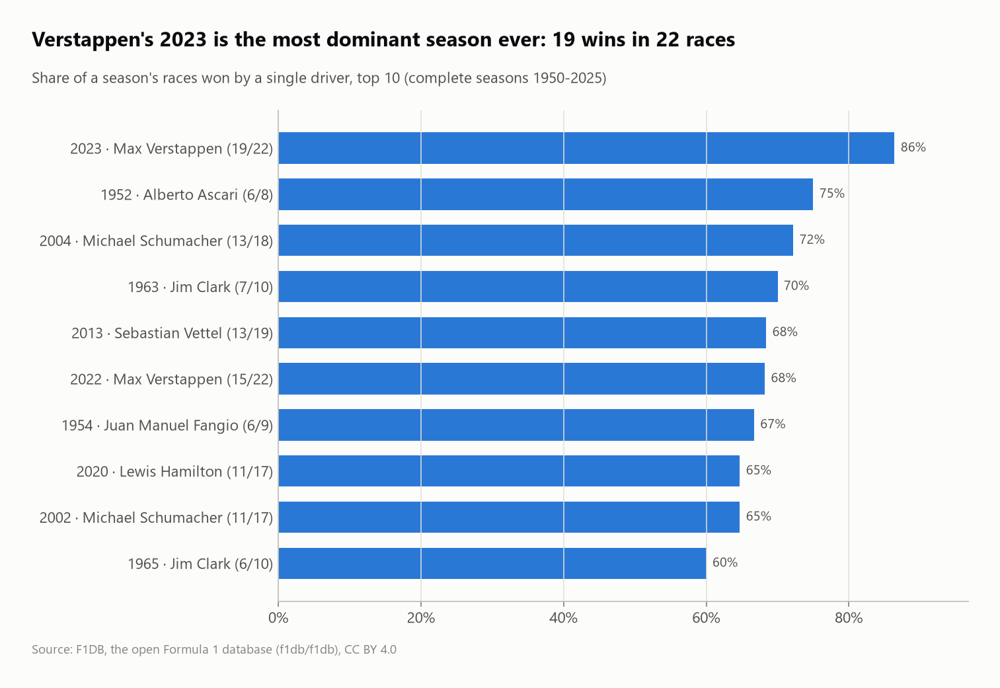
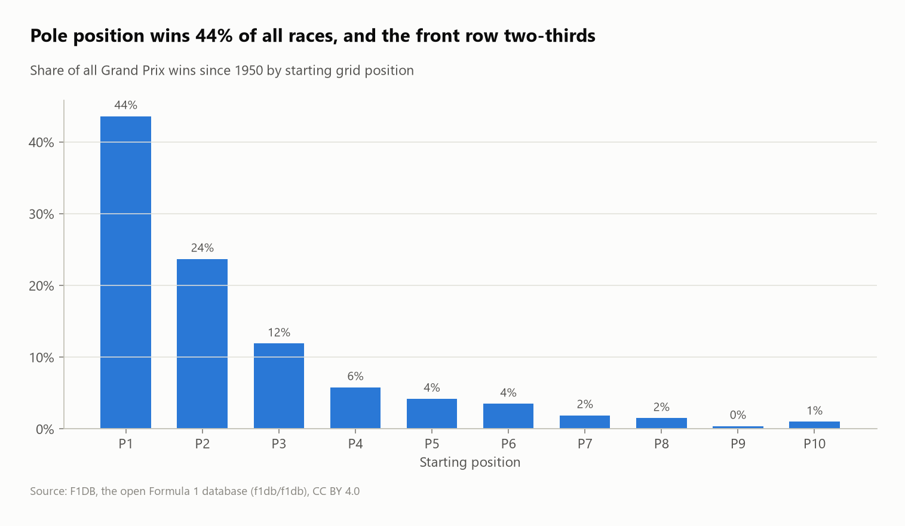
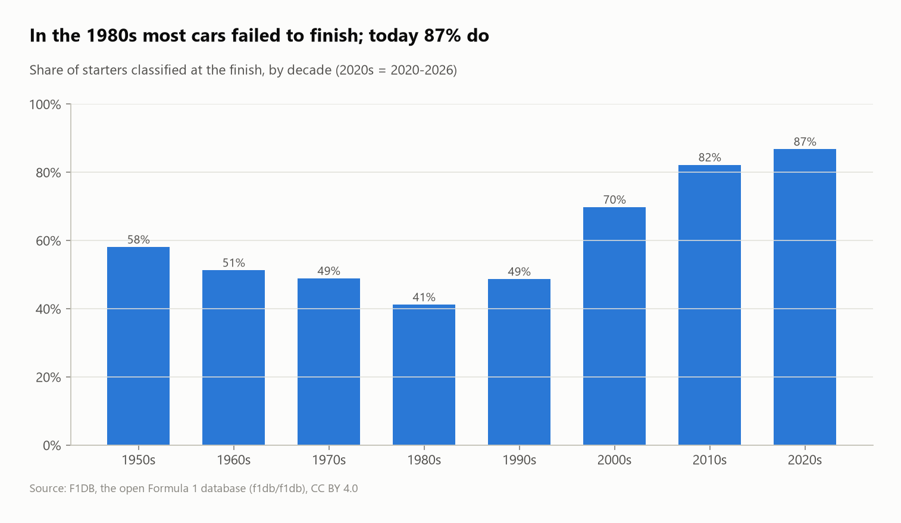

# Formula 1, 1950–2026: winners, eras, reliability and the value of pole

Every Formula 1 World Championship race since 1950 (**1,164 races, 27,621 race results**) from the open F1DB database, analyzed with SQL across a relational model of drivers, constructors, races, results and championships.



## Questions
1. Who has won the most, and who converts starts into wins best?
2. How much does the starting grid decide the race?
3. How has reliability changed over the decades?
4. What were the most dominant seasons and the dominant teams of each era?
5. Which countries produce the champions?

## Key findings
- **Two traps handled:**
  - The calendar contains **8 future 2026 races** with no results, so only races with results count, and season rankings use complete seasons (1950–2025).
  - There are **1,167 wins for 1,164 races**, because in the 1950s team-mates sometimes shared a car and both were credited.
- **Lewis Hamilton has the most wins (106 in 395 starts),** but among drivers with 50+ starts **Fangio has the best win rate: 41.4%** (24 wins in 58 starts), ahead of Jim Clark (33.8%).
- **Pole position wins 43.6% of all races, and the front row 67%.** Starting P10 or lower produced only 3.5% of all wins.
- **Pole matters more than ever:** 56% of 2020s races were won from pole, against 28% in the 1980s.
- **Reliability transformed the sport:** in the 1980s only **41% of starters finished**; in the 2020s, **87%** do.
- **Verstappen's 2023 is the most dominant season ever: 19 wins in 22 races (86%),** ahead of Ascari 1952 (75%) and Schumacher 2004 (72%).
- **One team per era:** Lotus (1960s), McLaren (1980s), Williams (1990s), Ferrari (2000s, 49% of wins), Mercedes (2010s, 47%), Red Bull (2020s, 47%).
- **The United Kingdom has 21 drivers' titles from 11 champions,** far ahead of Germany (12 titles, 3 champions).

| Win share by grid position | Finishing rate by decade |
|---|---|
|  |  |

## SQL techniques
- A **7-table relational model** (drivers, constructors, races, results, champions, countries) loaded from CSV
- `EXISTS` to separate run races from scheduled ones, **correlated subqueries** for per-season race counts
- **Top-1 per group** with `QUALIFY row_number() OVER (PARTITION BY decade ...)`, window shares with `sum(count(*)) OVER (PARTITION BY ...)`
- `count(*) FILTER`, decade bucketing, `HAVING` on minimum starts

## Dataset
| | |
|---|---|
| Source | [F1DB](https://github.com/f1db/f1db), latest release (`f1db-csv.zip`) |
| Size | 1,172 races (1,164 with results), 27,621 results, 917 drivers, 187 constructors |
| License | CC BY 4.0 |

> F1DB is updated after each Grand Prix, so a fresh `run.py` may include more 2026 races than this README.

## Run it
```bash
pip install -r ../../requirements.txt
python run.py
```
