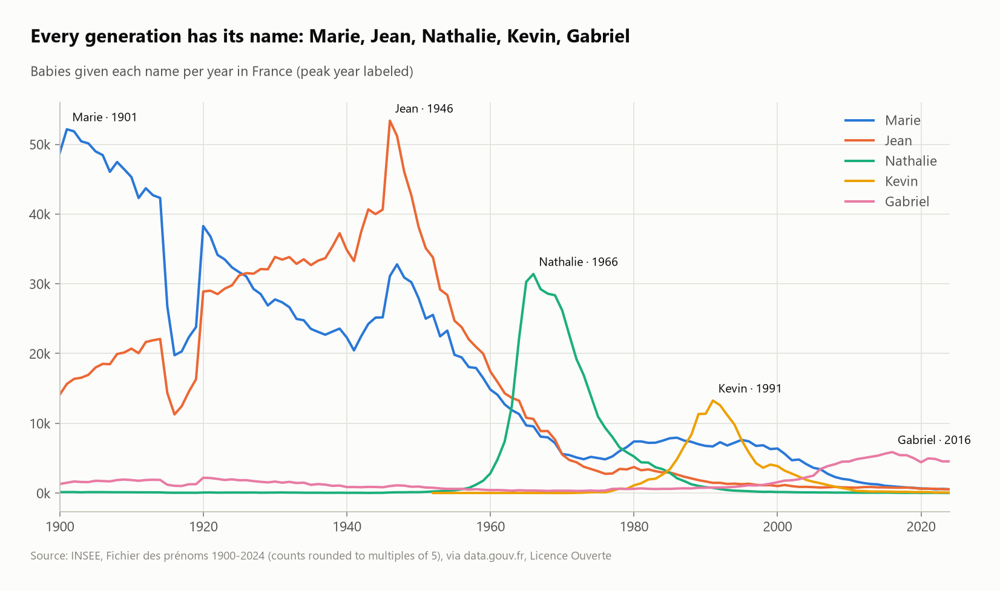
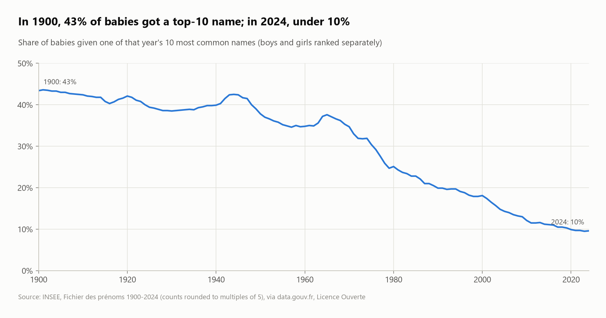
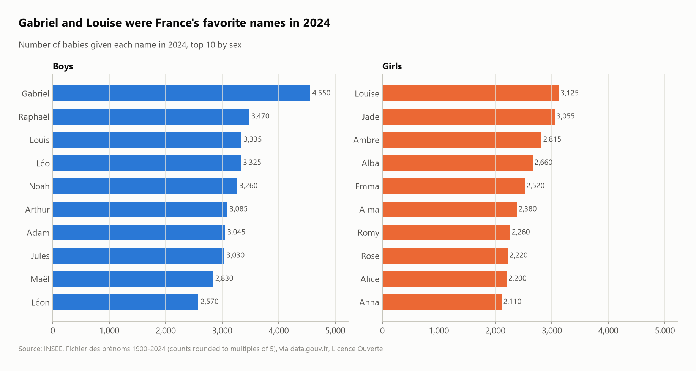

# French first names, 1900–2024: fashions, generations and diversity

INSEE's official file of first names given in France (**6.45 million rows**: national, regional and departmental counts from 1900 to 2024), analyzed with SQL: today's favorites, each generation's signature names, the collapse of name concentration, and regional differences.



## Questions
1. What does the file contain, and how precise are the counts?
2. What were the most given names in 2024, and of all time?
3. When did each classic name peak?
4. Are names becoming more diverse?
5. Which names are rising fastest, and do regions differ?

## Key findings
- **Every count is rounded to a multiple of 5** (100% of rows) for privacy, and very rare names are grouped under `RARES`. Totals are approximate, but trends are reliable.
- **Gabriel (4,550 babies) and Louise (3,125) were the top names of 2024.** Gabriel tops the boys' ranking in 10 of the 18 regions.
- **All-time champions: Marie (2.23 million, peak 1901) and Jean (1.91 million, peak 1946).**
- **Every generation has its name:** Nathalie peaked in 1966 (31,410 babies), Kevin in 1991 (13,260), Gabriel in 2016. The 1915–1919 dip on every curve is the World War I birth collapse.
- **Names are far more diverse:** in 1900, **43% of babies** got one of the year's 10 most common names; in 2024, **9.6%**. The number of distinct names grew from 1,736 to 14,529.
- **Fast risers:** Alba went from 85 babies in 2014 to 2,660 in 2024 (×31), Esmée ×26, Zayn ×23.
- **Regional flavor:** Malo leads in Bretagne, Adam and Alma in Île-de-France, and Inaya is the top girl's name in all five overseas regions.

| Name concentration | Top names 2024 |
|---|---|
|  |  |

## SQL techniques
- Reading **Parquet** directly, filtering one table that holds three geographic levels
- Code-to-name mapping with a `VALUES` table (including an escaped apostrophe: `'Côte d''Azur'`)
- `rank()` and `row_number()` **partitioned by sex and by region** with `QUALIFY` for top-N per group
- **`arg_max(year, babies)`** to find each name's peak year
- Concentration metric: top-10 share per year with nested windows; growth ratios with `FILTER` pivots; tuple `IN` filters

## Dataset
| | |
|---|---|
| Source | [INSEE – Fichier des prénoms](https://www.insee.fr/fr/statistiques/8894961) ([Parquet on data.gouv.fr](https://www.data.gouv.fr/datasets/base-prenoms-2024-insee)) |
| Size | 6,454,981 rows (711,069 national, 1,900,441 regional, 3,843,471 departmental) |
| License | Licence Ouverte / Open Licence (INSEE) |

## Run it
```bash
pip install -r ../../requirements.txt
python run.py
```
