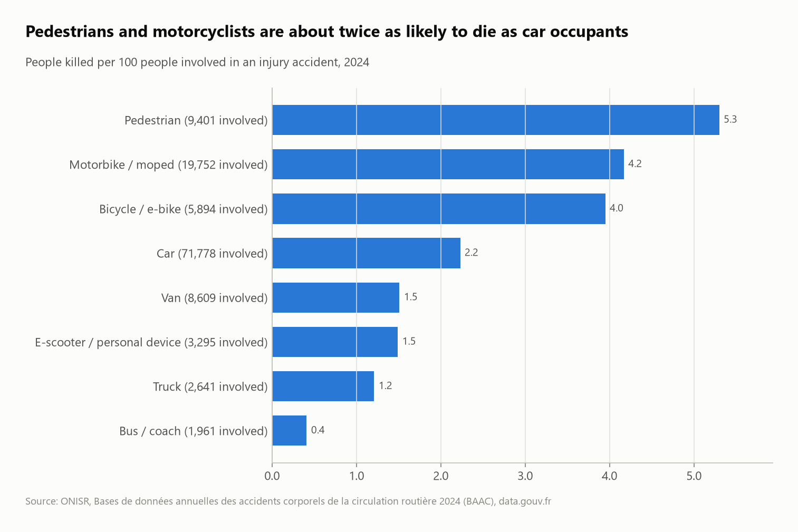
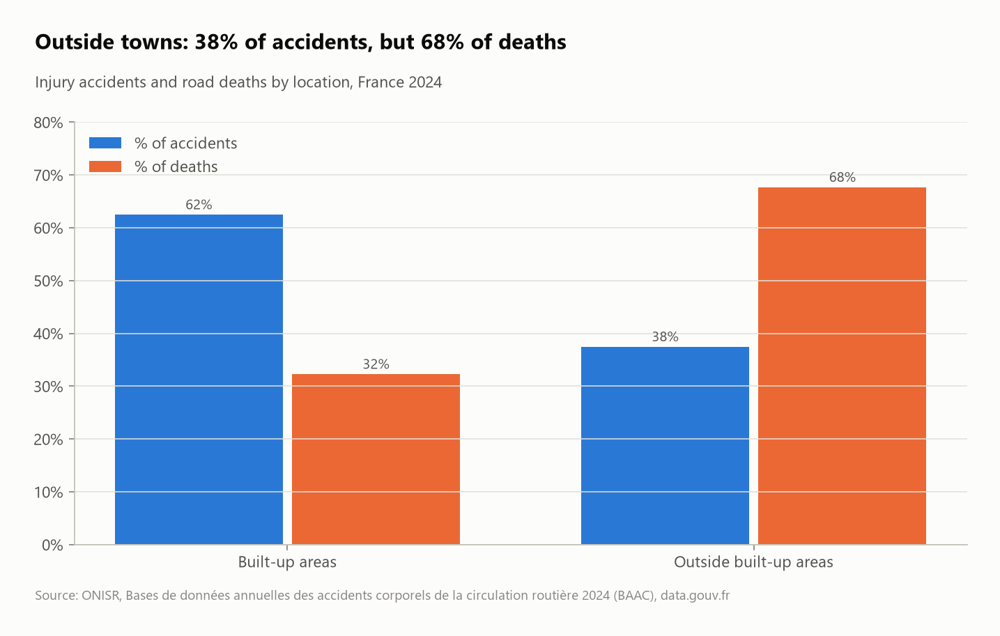
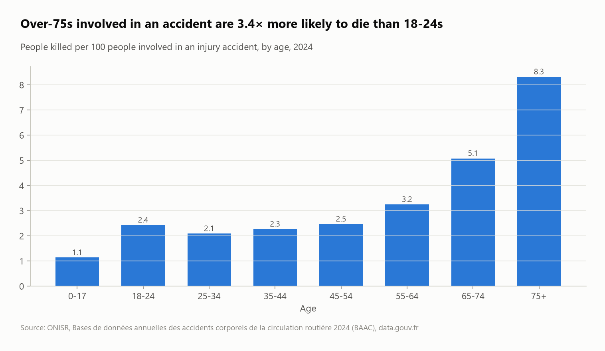

# Road accidents in France, 2024: who dies, where, and when

The official French road-accident database (BAAC, ONISR) for 2024: **54,402 injury accidents, 92,678 vehicles and 125,187 people** across four related tables. It's analyzed with SQL joins to find which road users, roads, hours and ages carry the risk.



## Questions
1. How do the four tables fit together, and where can joins go wrong?
2. Which road users are most at risk of dying when an accident happens?
3. Are rural roads more deadly than towns?
4. How do road type, light conditions, hour, age and seatbelt use change the outcome?

## Key findings
- **The fan-out trap:** an accident can have several "road" rows. A naive join returns **70,248 rows for 54,402 accidents (+29%)** and inflates every count. The model keeps one road per accident, verified in `grain_check`.
- **3,432 people were killed** (3,193 in mainland France, 239 overseas), 2.7% of everyone involved, and 19,126 were hospitalized.
- **Vulnerable road users:** **pedestrians (5.3 deaths per 100 involved)**, motorcyclists (4.2) and cyclists (4.0) die about twice as often as car occupants (2.2). Bus passengers rarely do (0.4).
- **Outside towns: 37.5% of accidents but 67.7% of deaths.** A rural accident is 3.5× more lethal than one in town (11.4 vs 3.3 deaths per 100 accidents).
- **Departmental roads are the deadliest (9.9 deaths per 100 accidents),** twice as lethal as motorways (4.9) and three times municipal roads (3.0).
- **Darkness kills:** at night on unlit roads, 14.5 deaths per 100 accidents, against 5.4 in daylight. The five most lethal hours of the day all fall between 01:00 and 05:00 (peak at 05:00: 14 deaths per 100 accidents).
- **Age:** a person aged 75+ involved in an accident is **3.4× more likely to die** than an 18–24-year-old (8.3 vs 2.4 per 100).
- **Seatbelts:** car occupants with no seatbelt recorded die 3.2× as often (5.5 vs 1.7 per 100). "Not recorded" may include missing data, so treat this as a strong signal rather than an exact effect.

| Rural vs urban | Lethality by age |
|---|---|
|  |  |

## SQL techniques
- **A table macro** (`CREATE MACRO baac(f) AS TABLE ...`) to read four files with the same CSV dialect
- **Grain control:** proving the fan-out (`naive_join_rows` vs `fixed_join_rows`) and fixing it with `QUALIFY row_number() OVER (PARTITION BY accident) = 1`
- **Multi-table joins** (accidents ↔ roads ↔ vehicles ↔ people) on composite keys, decoding categorical codes with `CASE`
- Rates with `count(*) FILTER (WHERE ...)` over `count(DISTINCT ...)`, share-of-total windows, decimal-comma parsing (`replace(',', '.')`)

## Dataset
| | |
|---|---|
| Source | [Bases de données annuelles des accidents corporels de la circulation routière](https://www.data.gouv.fr/datasets/bases-de-donnees-annuelles-des-accidents-corporels-de-la-circulation-routiere-annees-de-2005-a-2024/) (ONISR / Ministère de l'Intérieur), 2024 files |
| Files | `caract-2024.csv`, `lieux-2024.csv`, `vehicules-2024.csv`, `usagers-2024.csv` |
| License | Licence Ouverte / Open Licence 2.0 |

> Includes mainland France and overseas departments. "Killed" means died within 30 days, the official definition.

## Run it
```bash
pip install -r ../../requirements.txt
python run.py
```
